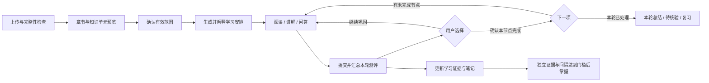

# 学习全链路边界与闭环修复实施计划

> **For agentic workers:** REQUIRED SUB-SKILL: Use superpowers:subagent-driven-development or superpowers:executing-plans to implement this plan task-by-task. Steps use checkbox syntax for tracking. 本文是待实施方案；本轮用户仅要求诊断和计划，所有实施项均未执行。

**Goal:** 让用户上传资料后获得范围明确的知识单元，能持续阅读、作答、恢复、确认完成并进入下一节点，最后得到如实区分任务、测评与掌握的整轮总结。

**Architecture:** 沿用现有资料版本、知识快照、计划、测评证据与笔记服务，补齐可学习单元元数据和统一的流程投影。展示名称与身份分离，章节与可排任务分离，会话保存、测评完成、任务确认和长期掌握保持独立。先修主流程和状态一致性，再上线新提取逻辑；旧快照继续可读，新知识经确认后采用。

**Tech Stack:** 原生JavaScript前端、Node测试，Python/FastAPI、pytest、MySQL/Neo4j/Qdrant/MinIO、现有模型worker与图谱worker。浏览器回归拟加入Playwright；本轮没有安装新依赖。

**依据:** [完整审计报告](C:/Users/27202/Desktop/KnowPath/docs/reviews/2026-10-17-learning-full-flow-audit.md)。报告登记15项已复现问题、10项代码审计确认问题、1项待专项复现风险，另有启动维护问题E01。

## 设计选择

| 方案 | 收益与代价 | 结论 |
| --- | --- | --- |
| 仅缩短标题、加下一步按钮 | 可快速缓解表面问题；页脚、跨页残句、身份碰撞和恢复缺口继续存在 | 只适合作为局部交付，不能作为整项修复的完成条件 |
| 修主流程，同时建立章节—知识单元—来源片段边界 | 复用已有证据与快照，分阶段改善；需要明确兼容与迁移 | **推荐** |
| 一次替换为全模型提取、自动规划与自动判掌握 | 改动范围大，成本、稳定性和可解释性验证困难 | 本轮不建议作为前置条件 |

## 一、先确定用户能理解的状态契约

### 1.1 五种事实分别展示

| 事实 | 成立条件 | 用户文案与动作 | 不能推导出的结论 |
| --- | --- | --- | --- |
| 本次学习已保存 | 学习会话成功结束；纯浏览也可明确自我确认已阅读 | “本次学习已保存”，可测评、继续阅读 | 时间足够不等于掌握 |
| 本轮测评已完成 | 该轮回答已记录，汇总结果已持久化 | 正确X、错误Y、待核验Z、独立有效证据N | 答完或满分不自动等于长期掌握 |
| 本节点任务已完成 | 用户明确确认；记录来源是测评后确认还是手工确认 | “本节点已完成”，下一项或整轮总结 | 手工确认不增加测评完成数或掌握证据 |
| 主题已掌握 | 现有有效独立证据达到策略门槛 | 展示题族、次数、间隔、应用题与下次复习时间 | 不用单一百分比冒充掌握概率 |
| 本轮任务已处理 | 当前轮次无可继续的未处理项，分别统计完成、跳过、延期 | 本轮总结与待核验、待复习、延期清单 | 有跳过/延期时不能称“全部完成” |

笔记“已生成”保持独立于“主题已掌握”。默认展示“笔记已生成；本节点任务完成；掌握证据仍缺……”，避免全部合并为“进行中”。

### 1.2 默认推进规则

1. 显式打开历史节点时允许回看，不能擅自切走。
2. 从“继续学习”或完成结果继续时，先恢复必须处理的活动会话或本任务未完成测评。
3. 需要重新规划时明确进入确认；否则选择当前顺序中下一项可执行的未完成任务。
4. 用户的旧选择只作为回看位置，不应压过默认的下一未完成任务。
5. 无待继续任务时进入本轮总结。存在延期、跳过、待核验或未来复习时分别列出。
6. 预算是安排与解释依据，不限制用户预览原文；超出本期容量不伪装为知识被阻塞。



不预设一个新的“80分就进入下一节点”规则。用户可以明确确认本轮学习结束；低分、待核验与证据不足仍如实显示，提供继续巩固选择。若后续产品要增加强制达标模式，应作为单独策略配置，不能与普通任务完成混为一谈。

### 1.3 新知识单元的最小契约

现有topic/snapshot结构可扩展以下元数据，不要求立即新建一套数据库：

```json
{
  "id": "unit_persisted_identity",
  "name": "基本数据类型与字面量",
  "kind": "concept",
  "parent_id": "chapter_persisted_identity",
  "is_learnable": true,
  "content_role": "instructional",
  "learning_objectives": ["按数值范围选择基本类型", "识别字面量默认类型和必要后缀"],
  "scope_summary": "基本类型、字面量和默认值；引用与null另列来源范围",
  "source_refs": [],
  "extraction": {"method": "document_structure", "parser_version": "learning-units-v1", "review_required": false}
}
```

上例是新契约形状，不是本轮新增真实topic。真实source_refs必须填写可核对的版本、片段和页行范围；不允许用空来源发布可测单元。ID持久保存并用结构身份、来源锚点维护映射，不由展示name直接决定。章节为容器；直属导言可成为自己的学习单元，不能仅取叶子导致正文遗漏。

## 二、阶段顺序与交付门槛

| 阶段 | 任务 | 可独立验收的结果 |
| --- | --- | --- |
| A：主流程与作答可靠性 | T01—T04 | 答案草稿保留，确认完成可继续，进度一致，测评模式与证据解释一致 |
| B：知识边界与范围规划 | T05—T07 | 指定PDF没有页脚/目录测评任务；标题、范围与工作量可理解；范围可批量选择 |
| C：恢复、快照与失败处理 | T08—T11 | 新标签恢复同一轮，旧空间继续读旧修订，失败可见，重解析不破坏旧来源，误完成可撤销 |
| D：专项风险与回归门禁 | T12—T14 | 计时旁路有明确验证结论，真实浏览器流程进入回归，启动脚本适配多Node路径 |

T09的旧快照读取和T10的解析产物不可变必须先于T05新提取结果的正式迁移上线。阶段B可先做隔离夹具与候选预览，不能提前覆盖真实旧知识。

## 三、实施任务

### T01 · 统一节点完成、下一节点和整轮总结

覆盖：R05、R13；依赖：先采用1.1—1.2契约。

**拟修改文件：**

- [frontend/src/workbench.js](C:/Users/27202/Desktop/KnowPath/frontend/src/workbench.js)：统一继续/回看/本轮结束解析。
- [frontend/src/study.js](C:/Users/27202/Desktop/KnowPath/frontend/src/study.js)：默认继续不优先旧已完成选择，显示目标与结束标准。
- [frontend/src/learning.js](C:/Users/27202/Desktop/KnowPath/frontend/src/learning.js)、[app.js](C:/Users/27202/Desktop/KnowPath/frontend/src/app.js)：结果页确认并继续、继续巩固、总结视图。
- [plans/service.py](C:/Users/27202/Desktop/KnowPath/py/knowpath_backend/learning/plans/service.py)、[schemas.py](C:/Users/27202/Desktop/KnowPath/py/knowpath_backend/learning/plans/schemas.py)、[workbench.py](C:/Users/27202/Desktop/KnowPath/py/knowpath_backend/learning/plans/workbench.py)：完成来源、版本校验、统一投影。
- 测试：[workbench.test.mjs](C:/Users/27202/Desktop/KnowPath/frontend/tests/workbench.test.mjs)、[study.test.mjs](C:/Users/27202/Desktop/KnowPath/frontend/tests/study.test.mjs)、[test_learning_plans_sessions.py](C:/Users/27202/Desktop/KnowPath/py/knowpath_backend/test/test_learning_plans_sessions.py)。

- [ ] 增加以下失败用例：第一节点满分后任务仍需明确确认；确认后下一待完成节点成为默认入口；保存的旧已完成节点不抢占默认继续；最后节点确认后进入总结；跳过、延期分别统计。
- [ ] 沿用现有任务更新入口并扩展完成来源。测评后确认须核对assessment确属当前plan/task且已completed；手工确认仍允许，但必须标明未因此新增测评/掌握事实。
- [ ] 完成写入使用expected_plan_version及稳定请求身份；结果未知时恢复同一操作。出现版本冲突先刷新，重新核对目标任务，不能静默完成另一任务。
- [ ] 服务端提交后返回或重读当前进度与下一动作。遵守既有锁序，不在持有plan锁时反向获取assessment锁。
- [ ] 结果页增加“确认本节点完成并继续”“继续巩固”，最后一项改为“查看本轮总结”；总结展示完成、跳过、延期、已完成测评、待核验、掌握与复习。
- [ ] 运行本任务的前后端定向测试及G01—G04浏览器验收，全部通过后才交付。

**通过标准：** 不需要进入任务管理页才能走完主线；一次确认仅改变目标任务；不自动把高分或时长写成mastered；显式回看旧节点仍可用。

### T02 · 保留未提交答案，活动更新不重建作答表单

覆盖：R06。

**拟修改：** [learning.js](C:/Users/27202/Desktop/KnowPath/frontend/src/learning.js)、[activity.js](C:/Users/27202/Desktop/KnowPath/frontend/src/activity.js)、[app.js](C:/Users/27202/Desktop/KnowPath/frontend/src/app.js)、[store.js](C:/Users/27202/Desktop/KnowPath/frontend/src/store.js)；测试[activity.test.mjs](C:/Users/27202/Desktop/KnowPath/frontend/tests/activity.test.mjs)、[assessment-experience.test.mjs](C:/Users/27202/Desktop/KnowPath/frontend/tests/assessment-experience.test.mjs)，以及T13浏览器用例。

- [ ] 建立草稿用例：选择选项或输入简答后，30秒心跳、切后台再返回、断网再恢复、刷新，题目未变时草稿保留。
- [ ] 草稿键为assessment_id + question_id +答案修订号。草稿与pendingAnswer分开：前者可编辑；后者是提交中必须重试的不可变请求。
- [ ] radio change与textarea input写入草稿状态及本地恢复存储，输入事件本身不触发整页重绘。完成、换题或修订变化时只清相应草稿。
- [ ] 心跳与活动状态通过局部更新渲染；其余必须重渲染时恢复焦点、选区和草稿。保留原文阅读器与活动计时。
- [ ] 验证提交请求已接收但响应丢失时，不把新草稿覆盖原提交，不重复新增证据。
- [ ] 运行T02单测与G05—G06浏览器用例。

**通过标准：** 连续等待至少35秒后选择和文本均仍在；只对同一题恢复；没有跨节点或跨空间草稿泄漏；不关闭心跳来规避问题。

### T03 · 修复任务保存后的缓存与进度投影

覆盖：R07。

**拟修改：** [app.js](C:/Users/27202/Desktop/KnowPath/frontend/src/app.js)、[workbench.js](C:/Users/27202/Desktop/KnowPath/frontend/src/workbench.js)、[progress.js](C:/Users/27202/Desktop/KnowPath/frontend/src/progress.js)、[workspace.js](C:/Users/27202/Desktop/KnowPath/frontend/src/workspace.js)；测试[workspace.test.mjs](C:/Users/27202/Desktop/KnowPath/frontend/tests/workspace.test.mjs)、[workbench.test.mjs](C:/Users/27202/Desktop/KnowPath/frontend/tests/workbench.test.mjs)、[route-integration.test.mjs](C:/Users/27202/Desktop/KnowPath/frontend/tests/route-integration.test.mjs)。

- [ ] 建立保存任务后仍停在管理页的回归，断言路线维持21项、完成数增长；模拟刷新失败也不能显示“确认无计划”。
- [ ] committed回调携带目标spaceId及受影响资源，仅刷新相关空间；成功旧数据在后台刷新期间继续可读。
- [ ] 明确not_loaded、loading、ready_empty、ready、有旧数据的error，空文案只用于ready_empty。
- [ ] 处理旧请求晚到、切换空间、计划版本变化，不让旧响应覆盖新状态。
- [ ] 运行T03定向测试与G03，核对页面、workbench与progress三处一致。

**通过标准：** 保存成功后不出现0/0闪回或长期空路线；刷新失败提供重试且不抹掉最近成功进度；不清空其他空间数据。

### T04 · 分开练习与独立测评协议，解释判分与掌握缺口

覆盖：R08、R09、R10、R14。

**拟修改：** [learning.js](C:/Users/27202/Desktop/KnowPath/frontend/src/learning.js)、[workspace-view.js](C:/Users/27202/Desktop/KnowPath/frontend/src/workspace-view.js)、[notes.js](C:/Users/27202/Desktop/KnowPath/frontend/src/notes.js)、[assessments/service.py](C:/Users/27202/Desktop/KnowPath/py/knowpath_backend/learning/assessments/service.py)、[schemas.py](C:/Users/27202/Desktop/KnowPath/py/knowpath_backend/learning/assessments/schemas.py)、[feedback.py](C:/Users/27202/Desktop/KnowPath/py/knowpath_backend/learning/assessments/feedback.py)、[notes/service.py](C:/Users/27202/Desktop/KnowPath/py/knowpath_backend/learning/notes/service.py)。

**测试：** [test_feedback_persistence.py](C:/Users/27202/Desktop/KnowPath/py/knowpath_backend/test/test_feedback_persistence.py)、[test_learning_mastery.py](C:/Users/27202/Desktop/KnowPath/py/knowpath_backend/test/test_learning_mastery.py)、[test_learning_notes_lifecycle.py](C:/Users/27202/Desktop/KnowPath/py/knowpath_backend/test/test_learning_notes_lifecycle.py)、[assessment-experience.test.mjs](C:/Users/27202/Desktop/KnowPath/frontend/tests/assessment-experience.test.mjs)、[learning.test.mjs](C:/Users/27202/Desktop/KnowPath/frontend/tests/learning.test.mjs)。

- [ ] 封存feedback_policy：practice=after_each_answer；diagnostic/retest=after_round。后端约束披露时机，不能只依赖前端传false；现有旧轮次保持原策略。
- [ ] 独立模式提交后直接显示下一题或提交回执，不进入“等待本题解析”的练习分支；完成后再披露整轮解析。
- [ ] 在无其他活动原文/问答的隔离夹具中，验证5个独立题族的复测不会被系统自己的前题解析污染；练习仍按同源规则标记辅助。
- [ ] 保留跨标签/空间的活动测评辅助保护和已提交答案保护。辅助原因返回具体种类与时间；测评开始前、用户打开帮助前、结果页均用可理解的文案说明影响。
- [ ] 简答题设置明确“保存作答与参考反馈，当前不自动可靠判分”；汇总列出correct/incorrect/unverified、有效独立证据数，不将unverified改成0分。
- [ ] 展示evidence_sufficiency.missing对应的题族、次数、间隔、应用题缺口；达到可复测时间后给入口，未达到时给真实日期。
- [ ] 笔记分开显示生成、任务确认与掌握条件；各测评标题与恢复文案使用封存kind，不再一律称诊断。
- [ ] 运行T04定向测试和G07—G09。24小时策略用可注入测试时钟验证；不据此宣称已验证真实用户的长期学习效果。

**通过标准：** 独立测评的解析不提前影响后题；练习、外部帮助与来源暴露仍有审计；用户知道哪些答案待核验以及为何未掌握。

### T05 · 建立一般教学PDF的知识单元提取与稳定身份

覆盖：R01、R02、S02、S08。正式迁移依赖T09、T10。

**拟修改：** [materials/service.py](C:/Users/27202/Desktop/KnowPath/py/knowpath_backend/learning/materials/service.py)、[pdf_structure.py](C:/Users/27202/Desktop/KnowPath/py/knowpath_backend/learning/materials/pdf_structure.py)、[knowledge/relations.py](C:/Users/27202/Desktop/KnowPath/py/knowpath_backend/learning/knowledge/relations.py)、[reconciliation.py](C:/Users/27202/Desktop/KnowPath/py/knowpath_backend/learning/knowledge/reconciliation.py)、[queries.py](C:/Users/27202/Desktop/KnowPath/py/knowpath_backend/learning/knowledge/queries.py)、[plans/policy.py](C:/Users/27202/Desktop/KnowPath/py/knowpath_backend/learning/plans/policy.py)、[plans/service.py](C:/Users/27202/Desktop/KnowPath/py/knowpath_backend/learning/plans/service.py)。

**拟新增：** `C:/Users/27202/Desktop/KnowPath/py/knowpath_backend/learning/materials/document_structure.py`用于一般教学文档结构；`C:/Users/27202/Desktop/KnowPath/py/knowpath_backend/learning/knowledge/learning_units.py`用于单元分组、目标、可测状态和身份映射。保留法律PDF现有结构路径的回归。

**测试：** [test_learning_materials.py](C:/Users/27202/Desktop/KnowPath/py/knowpath_backend/test/test_learning_materials.py)、[test_learning_graph_queries.py](C:/Users/27202/Desktop/KnowPath/py/knowpath_backend/test/test_learning_graph_queries.py)、[test_learning_graph_scope_contract.py](C:/Users/27202/Desktop/KnowPath/py/knowpath_backend/test/test_learning_graph_scope_contract.py)；拟新增`C:/Users/27202/Desktop/KnowPath/py/knowpath_backend/test/test_learning_units.py`。

- [ ] 先建立夹具：中文“一、”、数字“2.4”、跨页段落、重复页脚、同名概述、章节直属导言、混合文字/图像页、合法空白页、多层Markdown标题。
- [ ] 保留原始来源文本与页行定位；为每页输出覆盖状态。非文本页区分已知空白、需OCR/人工检查和解析失败，展示未覆盖页，不静默宣称全书已完成导入。
- [ ] 一般教学结构识别与页脚检测先确定章节和内容角色，再把同一语义单元的跨页片段归并。非学习内容仍保留来源，只默认不排任务、不自动出题。
- [ ] 生成简短知识标题和有限、可验证的目标。模型只做有来源约束的提炼与候选补充，低置信度进入预览确认；不凭章节顺序捏造前置依赖。
- [ ] 实现1.3契约，ID与name分离。同名不同父节点不合并，改显示标题不变ID；无法可靠匹配的新旧单元进入确认，不猜测继承掌握证据。
- [ ] 排计划只取is_learnable单元。章节直属正文单独覆盖；不把父容器和其全部子来源重复计时、重复出题。
- [ ] 用指定15页PDF验收：七个主章节组织清晰；不存在纯页码、目录或残句标题；正文页2—14可追溯覆盖；页15作为可选综合练习/总结；不要求必须恰好七个任务。
- [ ] 运行T05后端测试和G10—G11。以候选发布方式上线，旧空间采用更新前仍保持旧来源可读。

**通过标准：** 每个可排单元有短标题、目标、范围和有效来源；页脚不进入题库；两个“概述”身份分开；不同解析版本和旧测评保持可追溯。

### T06 · 范围默认、批量选择与前置约束使用同一规则

覆盖：R04、S03、S04；依赖T05的可学习单元元数据，兼容旧主题。

**拟修改：** [app.js](C:/Users/27202/Desktop/KnowPath/frontend/src/app.js)、[workspace-view.js](C:/Users/27202/Desktop/KnowPath/frontend/src/workspace-view.js)、[api.js](C:/Users/27202/Desktop/KnowPath/frontend/src/api.js)、[spaces/schemas.py](C:/Users/27202/Desktop/KnowPath/py/knowpath_backend/learning/spaces/schemas.py)、[spaces/service.py](C:/Users/27202/Desktop/KnowPath/py/knowpath_backend/learning/spaces/service.py)、[plans/ordering.py](C:/Users/27202/Desktop/KnowPath/py/knowpath_backend/learning/plans/ordering.py)。

**拟新增测试：** `C:/Users/27202/Desktop/KnowPath/frontend/tests/scope-picker.test.mjs`；扩展[test_learning_graph_scope_contract.py](C:/Users/27202/Desktop/KnowPath/py/knowpath_backend/test/test_learning_graph_scope_contract.py)、[test_learning_plan_order.py](C:/Users/27202/Desktop/KnowPath/py/knowpath_backend/test/test_learning_plan_order.py)。

- [ ] 新空间提供“学习全部有效内容”和“自选章节”；默认选择前者。按资料、章节提供全选、取消和搜索，显示选中数及预计工作量。
- [ ] 单个单元的纳入/排除互斥，自动加入前置显示来源与原因，排除操作保留但不能静默制造无法规划的范围。
- [ ] 服务端完整持久化并返回topic_ids、excluded_topic_ids、include_prerequisites及版本；两个范围编辑入口重开和刷新后一致。
- [ ] 抽出范围与规划共用的约束判定：有效已掌握前置可视为满足；未掌握的硬前置被排除时保存前返回具体冲突及调整选项；软建议不强制纳入。
- [ ] 沿用canonical topic与精确知识修订校验，不能用陈旧mastered状态豁免新知识依赖。
- [ ] 运行T06定向测试与G12。使用大量主题夹具验证批量操作，避免逐项手工点击成为必要流程。

**通过标准：** 普通用户可直接学习全部有效内容；范围保存成功后不会因同一前置规则必然导致计划失败；重开不重置开关或排除项。

### T07 · 解释预算窗口与排期，不暴露内部原因码

覆盖：R12。

**拟修改：** [progress.js](C:/Users/27202/Desktop/KnowPath/frontend/src/progress.js)、[learning.js](C:/Users/27202/Desktop/KnowPath/frontend/src/learning.js)、[app.js](C:/Users/27202/Desktop/KnowPath/frontend/src/app.js)、[plans/rolling.py](C:/Users/27202/Desktop/KnowPath/py/knowpath_backend/learning/plans/rolling.py)。测试[progress.test.mjs](C:/Users/27202/Desktop/KnowPath/frontend/tests/progress.test.mjs)、[plan-form.test.mjs](C:/Users/27202/Desktop/KnowPath/frontend/tests/plan-form.test.mjs)、[test_learning_rolling_schedule.py](C:/Users/27202/Desktop/KnowPath/py/knowpath_backend/test/test_learning_rolling_schedule.py)。

- [ ] 为window_capacity、deadline_capacity、前置受阻、用户延期建立完整显示映射；未知原因使用可读兜底，不直接展示内部码。
- [ ] 计划预览分别显示所选总工作量、窗口容量、已安排分钟、未安排分钟/节点。420分钟对210分钟的场景必须明确显示差额，并提供延长窗口/调整预算/缩小范围。
- [ ] allocation按日期和phase解释。同一天study和answer显示为同日两个阶段；只有真实定义的时间段才称时段。
- [ ] 各入口使用同一排期说明，保持超预算节点可预览，避免把容量不足误解为资料或前置错误。
- [ ] 运行T07定向测试与G13。

### T08 · 从服务端恢复在途测评，并管理创建意图

覆盖：R11、S09、S11；T01使用此处的恢复投影。

**拟修改：** [api/routers/assessments.py](C:/Users/27202/Desktop/KnowPath/py/knowpath_backend/learning/api/routers/assessments.py)、[assessments/service.py](C:/Users/27202/Desktop/KnowPath/py/knowpath_backend/learning/assessments/service.py)、[plans/workbench.py](C:/Users/27202/Desktop/KnowPath/py/knowpath_backend/learning/plans/workbench.py)、[learning.js](C:/Users/27202/Desktop/KnowPath/frontend/src/learning.js)、[workbench.js](C:/Users/27202/Desktop/KnowPath/frontend/src/workbench.js)、[progress.js](C:/Users/27202/Desktop/KnowPath/frontend/src/progress.js)、[app.js](C:/Users/27202/Desktop/KnowPath/frontend/src/app.js)、[api.js](C:/Users/27202/Desktop/KnowPath/frontend/src/api.js)。

**测试：** [test_learning_assessment_api.py](C:/Users/27202/Desktop/KnowPath/py/knowpath_backend/test/test_learning_assessment_api.py)、[learning.test.mjs](C:/Users/27202/Desktop/KnowPath/frontend/tests/learning.test.mjs)、[route-integration.test.mjs](C:/Users/27202/Desktop/KnowPath/frontend/tests/route-integration.test.mjs)。

- [ ] 提供按空间/任务列出可恢复测评的只读查询，返回id、kind、状态、run_id、归属、已答/目标和更新时间，不返回未披露答案键。
- [ ] 工作台带可恢复测评；路由支持assessment_id。结果未完成的记录链接改为“继续测评”，completed链接保持结果页。
- [ ] 新标签、刷新或关闭后重开，恢复生成、作答、评分中的同一轮；多个在途项让用户选，不凭最后一个sessionStorage值决定全部。
- [ ] 创建意图分为服务端明确拒绝且未创建、结果未知、已接收。只对确定拒绝允许重设body/key；网络超时继续使用原请求与幂等键。
- [ ] 先完成task/plan关联初始化再开放设置，用户更改后不被晚到默认值覆盖；提交和恢复都使用原轮次封存归属。
- [ ] 在新标签恢复4/5进度后完成，校对assessment_id与题目一致，证据不重复；验证旧完成轮次和另一空间不被覆盖。
- [ ] 运行T08测试与G14—G15。

**通过标准：** 本地恢复指针丢失不等于测评不可继续；确定拒绝后的新意图可生效；结果未知时不制造重复轮次；不会通过新标签绕开测评归属或答案披露限制。

### T09 · 精确读取学习空间绑定的知识修订

覆盖：S01；是新提取迁移上线的前置门槛。

**拟修改：** [api.js](C:/Users/27202/Desktop/KnowPath/frontend/src/api.js)、[api/routers/graphs.py](C:/Users/27202/Desktop/KnowPath/py/knowpath_backend/learning/api/routers/graphs.py)、[api/routers/materials.py](C:/Users/27202/Desktop/KnowPath/py/knowpath_backend/learning/api/routers/materials.py)、[knowledge/queries.py](C:/Users/27202/Desktop/KnowPath/py/knowpath_backend/learning/knowledge/queries.py)。测试[api.test.mjs](C:/Users/27202/Desktop/KnowPath/frontend/tests/api.test.mjs)、[test_learning_graph_queries.py](C:/Users/27202/Desktop/KnowPath/py/knowpath_backend/test/test_learning_graph_queries.py)、[test_learning_knowledge_updates.py](C:/Users/27202/Desktop/KnowPath/py/knowpath_backend/test/test_learning_knowledge_updates.py)。

- [ ] 在同一material_version上发布graph1、graph2，空间仍绑定graph1，建立图谱、主题、阅读和测评均可继续的失败测试。
- [ ] 查询支持graph_revision_id；校验其属于指定资料及版本，并读取不可变publication snapshot。未指定修订的资料库查询保留“最新”语义。
- [ ] 学习空间一律传绑定修订。用户确认采用更新前不静默切换，采用后按既有变更规则处理过期证据与重规划。
- [ ] 验证graph和topics来自同一修订；错误修订、已删除版本返回明确错误，不回退最新以掩盖问题。
- [ ] 运行T09定向测试及G16。

### T10 · 导入阶段、最终失败、重解析和候选发布生命周期

覆盖：R03、S05、S06、S07；与T05迁移共同验收。

**拟修改：** [workers/material_ingest.py](C:/Users/27202/Desktop/KnowPath/py/knowpath_backend/learning/workers/material_ingest.py)、[workers/graph.py](C:/Users/27202/Desktop/KnowPath/py/knowpath_backend/learning/workers/graph.py)、[knowledge/reconciliation.py](C:/Users/27202/Desktop/KnowPath/py/knowpath_backend/learning/knowledge/reconciliation.py)、[materials/service.py](C:/Users/27202/Desktop/KnowPath/py/knowpath_backend/learning/materials/service.py)、[workspace-view.js](C:/Users/27202/Desktop/KnowPath/frontend/src/workspace-view.js)、[workspace.js](C:/Users/27202/Desktop/KnowPath/frontend/src/workspace.js)、[app.js](C:/Users/27202/Desktop/KnowPath/frontend/src/app.js)。

**测试：** [test_learning_graph_worker.py](C:/Users/27202/Desktop/KnowPath/py/knowpath_backend/test/test_learning_graph_worker.py)、[test_learning_graph_reconciliation.py](C:/Users/27202/Desktop/KnowPath/py/knowpath_backend/test/test_learning_graph_reconciliation.py)、[test_learning_raw_materials.py](C:/Users/27202/Desktop/KnowPath/py/knowpath_backend/test/test_learning_raw_materials.py)、[material-upload.test.mjs](C:/Users/27202/Desktop/KnowPath/frontend/tests/material-upload.test.mjs)。

- [ ] 导入投影分别返回文件接收、解析、索引/图谱准备、待确认、可学习及失败阶段，状态来自run与修订事实，不依赖material.ready单一字段。
- [ ] worker耗尽重试后写入候选失败终态、失败阶段、可重试性；查询和前端显示原因与恢复动作。已有发布版本保持可用。
- [ ] 区分“重试失败任务”“从已解析内容重新建候选”“用新解析器重新解析原文件”，三个动作与说明对应真实行为。
- [ ] 重解析生成新的不可变解析产物/资料版本，记录parser_version并复用原文件内容；不能原地替换旧版chunks，造成旧计划与测评来源失效。显式重解析应能绕过普通重复上传复用。
- [ ] 同基线候选的创建、复用与发布串行校验；发布时原子标记同基线旧候选失效。失效候选可查看历史，但不能再提交发布。
- [ ] 上传成功后提供知识内容预览、确认发布和创建空间的明确入口；状态失败时不继续提示“稍后刷新”。
- [ ] 用隔离worker夹具验证索引失败、重试成功、同基线双候选、解析器升级和旧来源可读；运行T10定向测试与G17。

**通过标准：** 每个处理中状态有成功或失败终点；界面“重新解析”确实重读原文件；重复点击不会留下可误发布的旧候选；旧快照和来源仍可读。

### T11 · 支持撤销误完成，保留历史事实

覆盖：R15。

**拟修改：** [plans/service.py](C:/Users/27202/Desktop/KnowPath/py/knowpath_backend/learning/plans/service.py)、[plans/schemas.py](C:/Users/27202/Desktop/KnowPath/py/knowpath_backend/learning/plans/schemas.py)、[workspace-view.js](C:/Users/27202/Desktop/KnowPath/frontend/src/workspace-view.js)、[study.js](C:/Users/27202/Desktop/KnowPath/frontend/src/study.js)、[app.js](C:/Users/27202/Desktop/KnowPath/frontend/src/app.js)。扩展[test_learning_plans_sessions.py](C:/Users/27202/Desktop/KnowPath/py/knowpath_backend/test/test_learning_plans_sessions.py)、[workspace.test.mjs](C:/Users/27202/Desktop/KnowPath/frontend/tests/workspace.test.mjs)。

- [ ] 增加“撤销本次任务完成”的明确操作，核对当前计划版本、当前有效节点与空间状态，记录原因及原完成事件。
- [ ] 撤销后回到可学习状态，重新打开会话与路线；不删除原会话、测评、笔记内容或独立证据。
- [ ] 历史、失效、归档计划不通过此操作重新激活；版本冲突返回可恢复提示。
- [ ] 核对任务进度可下降而历史测评与掌握事实不被重置，运行T11定向测试与G18。

### T12 · 验证测评旁路返回阅读是否残留暂停原因

覆盖：S10；这是先验证再决定是否修复的任务。

**核查文件：** [progress.js](C:/Users/27202/Desktop/KnowPath/frontend/src/progress.js)、[learning.js](C:/Users/27202/Desktop/KnowPath/frontend/src/learning.js)、[assessments/activity.py](C:/Users/27202/Desktop/KnowPath/py/knowpath_backend/learning/assessments/activity.py)、[plans/activity.py](C:/Users/27202/Desktop/KnowPath/py/knowpath_backend/learning/plans/activity.py)。

- [ ] 在隔离空间启动活动学习会话，不结束；从学习记录进入关联测评，答一题后返回阅读，等待至少一次心跳。
- [ ] 比较前后pause_reasons和服务端active_seconds，同时验证手动暂停、后台隐藏、断网暂停仍生效。
- [ ] 若未复现，记录实际路径与测试结论，关闭风险，不以风险名义重构计时。
- [ ] 若复现，只在离开测评阶段时正确发送/结算assessment_end；阅读resume不能无条件清除manual_pause、hidden或disconnected。增加独立回归后修改对应模块。
- [ ] 运行计时定向测试及G19，要求学习和作答时间不重计、返回阅读后不永久停计。

### T13 · 建立跨页面浏览器回归与兼容门禁

覆盖：所有R类；承接S类隔离夹具。已有206项定向测试通过不能替代本任务。

**拟新增：** `C:/Users/27202/Desktop/KnowPath/frontend/playwright.config.mjs`、`C:/Users/27202/Desktop/KnowPath/frontend/tests/e2e/learning-flow.spec.mjs`。拟修改[frontend/package.json](C:/Users/27202/Desktop/KnowPath/frontend/package.json)，将浏览器测试与现有Node单测命令分开。

- [ ] 在独立测试数据与服务配置中提供固定、可核对来源的题库。不能在用户开发数据库清数据，也不让自动回归依赖真实模型输出的随机性。
- [ ] 将G01—G19中适合自动化的浏览器交互纳入回归，等待真实提交完成和正确assessment/task归属，不用仅URL变化或旧失败文案判断成功。
- [ ] 添加真实35秒心跳场景；使用全新浏览器上下文检验恢复，而不只刷新同一标签。
- [ ] 每轮用服务端task_id、assessment_id、状态与题数核对页面，失败时保留请求体、截图、跟踪与服务端投影；日志脱敏，不保存本地鉴权令牌。
- [ ] 新旧快照混合、无新元数据的旧主题、旧测评恢复均进入兼容测试。标题改名不能改变旧答题归属；分拆/合并单元不可无证据继承mastered。
- [ ] 用原指定PDF另跑一次真实模型人工烟测：确认七章结构、完整走完全部可学习单元、补测、最终总结与笔记。
- [ ] 分批提交和发布；每阶段独立通过其门禁，避免用一次大范围重写替代验证。

### T14 · 修复本地启动脚本的多Node路径处理

覆盖：E01；不阻塞业务流程修复。

**拟修改：** [start-local.ps1](C:/Users/27202/Desktop/KnowPath/start-local.ps1)。

- [ ] 用多个Node可执行路径的PowerShell夹具重现Source数组问题。
- [ ] 明确选择有效的单一解释器路径，验证版本与规范化后的路径；服务复用识别与该选择一致。
- [ ] 验证单一路径、多路径、Node版本不足、端口被其他程序占用等情况。仍不得随意终止已有进程。
- [ ] 对现有Docker容器做只读健康检查并启动应用，不重建卷、不覆盖环境配置；输出明确可访问地址。

## 四、浏览器验收场景

| 编号 | 操作 | 必须看到的结果 |
| --- | --- | --- |
| G01 | 上传本轮PDF，确认知识、按默认范围生成计划 | 用户无需逐个勾全部主题，进入结构清晰的有效学习单元 |
| G02 | 正常节点阅读后结束并测评，再确认本节点完成 | 打开正确的下一待完成节点；分数与mastered保持独立 |
| G03 | 从任务管理页保存完成，保持原页 | 路线不变0/0，任务与累计进度一致；刷新失败保留旧值并给重试 |
| G04 | 最后节点结束；分别测试全部完成、含跳过、含延期 | 进入总结，三类统计与措辞正确，无旧节点抢占默认入口 |
| G05 | 选中单选、输入简答后等待35秒 | 答案、光标、题目均保留 |
| G06 | 作答时切后台、断网重连、刷新；提交响应丢失后恢复 | 草稿可恢复；已接收请求不重复计证据 |
| G07 | 独立模式的5题共享来源，期间不打开原文或帮助 | 前4题不提前披露解析，系统不会用自己的解析污染后题独立性 |
| G08 | 练习即时反馈；测评期间另标签打开同源原文/问答 | 练习解析可读；真实辅助正确标记并显示具体原因 |
| G09 | 选择混合题并完成，打开笔记与掌握状态 | 开始前说明简答边界；结果单列待核验、缺失证据和下次补测时间 |
| G10 | 检查讲义的封面、页脚、跨页正文和第15页总结 | 不考目录顺序或页码；正文覆盖可核对，总结用途明确 |
| G11 | 导入同名“概述”与含“2.4”的结构夹具，再只修改显示名 | 不合并不同单元，不生成纯数字标题，改名不丢学习关联 |
| G12 | 全选章节、排除一项、关闭前置，保存并重开/刷新 | 范围一致；硬前置冲突在保存前解决，已掌握前置可正确满足 |
| G13 | 420分钟范围、210分钟窗口；同日学习和作答两阶段 | 显示容量差额与可调动作，不出现window_capacity或假时段数 |
| G14 | 已答4/5后用全新标签或浏览器上下文打开 | 能选中并继续原assessment_id，已答题不丢、不重复出题 |
| G15 | 模拟确定拒绝后改设置；模拟响应未知后重试；异步加载时改模式 | 新意图仅在确定拒绝时重建；未知结果复用key；异步默认不覆盖用户选择 |
| G16 | 同资料版本发布新知识修订，旧空间暂不采用，再采用 | 旧空间持续读原快照；采用后才切换、提示影响与必要重规划 |
| G17 | 在测试夹具中索引终失败、重试、重解析、双候选发布 | 每个失败可见且可恢复，旧来源不失效，过期候选不能发布 |
| G18 | 误完成后撤销，再继续学习 | 当前任务可重新记录会话，原测评/笔记/证据保留 |
| G19 | 保留活动学习会话，旁路测评答一题再回阅读 | 无重复计时、无残留assessment暂停，手动/隐藏/断网暂停仍正确 |

## 五、验证命令与发布标准

以下是实施时执行的命令；本轮只执行了审计报告中注明的111项前端、95项后端基线。不得把下面尚未执行的完整检查写成已通过。

前端，工作目录`C:/Users/27202/Desktop/KnowPath/frontend`：

```powershell
npm run check
npm test
npm exec playwright test --config playwright.config.mjs
```

后端，工作目录`C:/Users/27202/Desktop/KnowPath/py`：

```powershell
.\.venv\Scripts\python.exe -m pytest knowpath_backend/test/test_feedback_persistence.py knowpath_backend/test/test_learning_mastery.py knowpath_backend/test/test_learning_assessment_api.py knowpath_backend/test/test_learning_plans_sessions.py knowpath_backend/test/test_learning_plan_order.py knowpath_backend/test/test_learning_rolling_schedule.py -q
.\.venv\Scripts\python.exe -m pytest knowpath_backend/test/test_learning_materials.py knowpath_backend/test/test_learning_graph_queries.py knowpath_backend/test/test_learning_graph_scope_contract.py knowpath_backend/test/test_learning_graph_reconciliation.py knowpath_backend/test/test_learning_graph_worker.py knowpath_backend/test/test_learning_knowledge_updates.py knowpath_backend/test/test_learning_notes_lifecycle.py -q
.\.venv\Scripts\python.exe -m pytest knowpath_backend/test/test_learning_units.py -q
```

每个任务先运行其最小失败用例，确认复现，再实现和验证；关联用例通过后进入下一任务。全量回归及浏览器门禁在阶段收敛后执行，不对低影响文案逐项增加机械镜像测试。

### 迁移与发布检查

- [ ] 旧资料版本、旧chunk与publication snapshot保持不可变且可读。
- [ ] 新解析器生成候选，用户采用前旧空间不变化；知识更新能准确预览影响。
- [ ] 单元改名保留身份；拆分/合并映射必须可核验，存在歧义时标为待重新评估，不迁移成已掌握。
- [ ] 旧题目、旧答案、辅助标记与判分策略保留审计，不为提高掌握率回写旧分数。
- [ ] 阶段A所有P1流程用例通过；阶段B无目录/页脚进入任务；阶段C恢复与快照兼容通过；G01—G19各有结果或S10未复现的明确结案证据。
- [ ] 原PDF真实模型烟测完成，最终总结、待核验、笔记与复习入口一致。
- [ ] 回滚仅切回旧提取/界面策略与入口，仍能读取已产生的新旧数据；不靠清库回滚。

## 六、问题覆盖映射

| 问题 | 任务 |
| --- | --- |
| R01、R02、S02、S08 | T05，迁移前置T09/T10 |
| R03、S05、S06、S07 | T10 |
| R04、S03、S04 | T06 |
| R05、R13 | T01 |
| R06 | T02 |
| R07 | T03 |
| R08、R09、R10、R14 | T04 |
| R11、S09、S11 | T08 |
| R12 | T07 |
| R15 | T11 |
| S01 | T09 |
| S10风险 | T12，复现后再决定修复 |
| E01 | T14 |
| 全链路质量与旧数据兼容 | T13及各任务的验收门槛 |

**本轮交付边界：** 诊断报告、证据与本计划。没有执行以上代码修改、数据迁移、依赖安装、提交、合并或发布。
