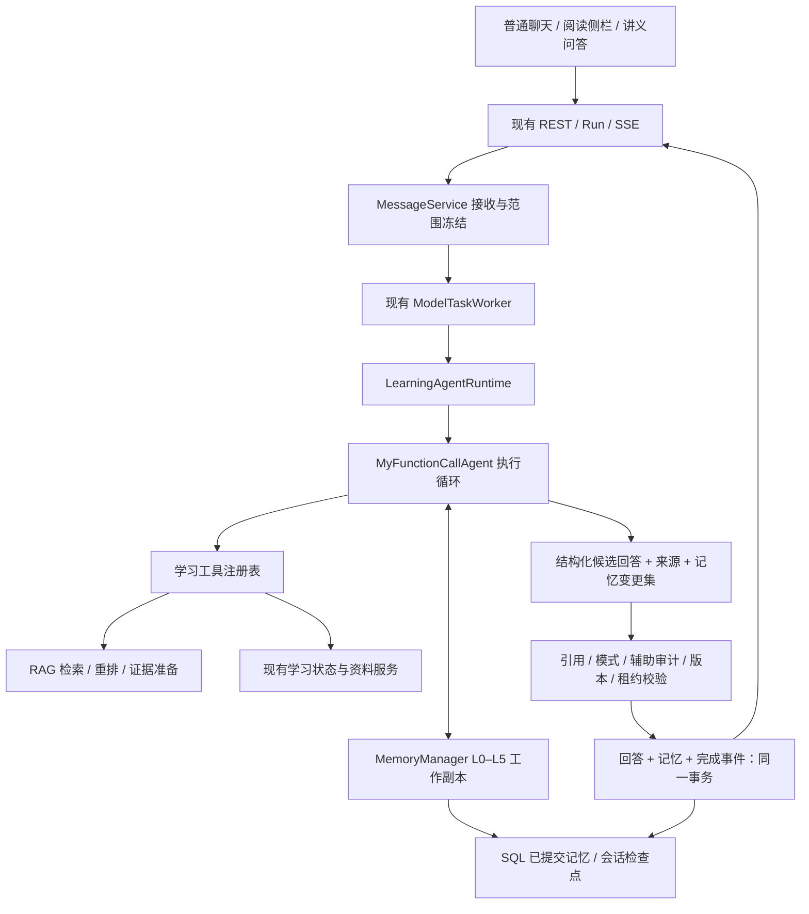

# Web 通用 Agent 与完整 L0–L5 记忆接入执行计划

> **For agentic workers:** REQUIRED SUB-SKILL: Use superpowers:executing-plans to implement this plan task-by-task. Steps use checkbox (`- [ ]`) syntax for tracking.

**Goal:** 所有 Web 对话入口统一使用现有通用 Agent 执行循环与完整 L0–L5 记忆，替换当前对话编排和消息记忆投影；保留测评、规划、讲义生成、笔记生成等业务服务及其数据权威。

**Architecture:** 为 `MyFunctionCallAgent` 和 `MemoryManager` 增加可注入的记忆、上下文与提交接口，构建学习场景运行时。完整记忆使用 Web SQL 存储和事务，Agent 在请求隔离的工作副本中运行；校验通过后，回答与记忆变更原子提交。RAG 拆分为资料检索、证据准备及答案校验能力，供 Agent 调用，不再作为第二条独立对话生成链。

**Tech Stack:** Python 3.13+、FastAPI、SQLAlchemy、Alembic、现有 Function Calling Agent、现有记忆层与 ContextEngine、现有 RAG 插件、现有 REST/SSE 和后台 Worker、pytest、Node 内置测试。

**日期：** 2026-10-24。

**状态：** 实施中。已完成第二轮完整性与边界复核，并建立隔离工作区和离线基线；任务结果及剩余边界见 [执行记录](../../implementation/2026-10-24-web-agent-integration-progress.md)。复核发现、代码证据及任务映射见 [完整性审查记录](../../implementation/2026-10-24-web-agent-plan-review.md)。

**已确认范围：** 用户选择“替换所有对话入口：通用 Agent + 完整 L0–L5，保留测评、规划等业务服务”。

**路径约定：** 仓库为 `C:/Users/27202/Desktop/KnowPath`。下文 `core/`、`agents/`、`memory/`、`learning/`、`conversations/` 等后端文件简写分别相对 `py/knowpath_backend/` 或已明确的 `learning/` 父模块；仅写文件名的测试相对 `py/knowpath_backend/test/`。带 `py/`、`frontend/`、`docs/` 前缀的路径相对仓库。Python 命令在 `py/` 执行，前端命令在 `frontend/` 执行。标注“新增”的文件和接口是本计划交付物，不代表当前已经存在。

---

## 1. 范围和最终行为

### 1.1 必须替换的入口

| 入口或模式 | 最终执行方式 | 必须保留的用户行为 |
| --- | --- | --- |
| 学习空间普通对话 | 学习 Agent + L0–L5 | 新会话、续聊、历史查询、取消和重连 |
| 原文阅读侧栏 | 同一运行时，绑定原文版本 | 只访问当前允许的资料；原文引用可定位 |
| 讲义问答 | 同一运行时，绑定讲义指纹和来源 | 讲义上下文、版本失效检测和来源追踪 |
| `answer_mode=auto` | Agent 内部路由和工具调用 | 资料依据与通用知识补充明确区分 |
| `answer_mode=material` | 强制经过资料证据门禁 | 依据不足时明确说明；禁止无来源断言 |
| `answer_mode=general` | 通用回答，保留学习辅助审计 | 不伪造资料引用，不绕开测评辅助标记 |
| 测评过程中的聊天求助 | 同一运行时，使用现有受限帮助策略 | 不泄露隐藏答案；独立作答证据仍由业务服务判定 |

### 1.2 保留与本次不新增的内容

- 测评生成、作答评分、掌握度、复习、学习计划、讲义生成和笔记生成继续由现有业务服务处理，不把结果改成模型自由写库。
- 保留资料摄取、知识图谱发布、RAG 插件、原文恢复、资料授权、辅助使用审计和版本校验。
- Web 默认工具仅覆盖资料检索、允许的学习状态查询及记忆操作。本次不顺带开放文件编辑、Shell 或任意业务写操作。
- L0 支持学习空间内跨会话记忆；本次默认不跨学习空间传播记忆。不新增多用户账户体系，也不拿访问 Token 作为用户身份键。
- 不重做前端布局。必要时只修改事件消费、记忆管理入口及契约测试。

### 1.3 “完整 L0–L5”的验收含义

| 层 | 必须实际运行的能力 | 持久化与恢复 |
| --- | --- | --- |
| L0 核心记忆 | 显式记住、固定、忘记；种子晋升、热度晋升、衰减和冲突处理 | SQL 卡片，包含来源依赖、生命周期和忘记标记 |
| L1 工作记忆 | 完整问答轮次、容量约束、近期保护、驱逐和重新加载 | 会话检查点；重启后恢复相同已提交状态 |
| L2 摘要 | 驱逐触发压缩、待压缓冲、来源追踪、冲突后校正 | 摘要及缓冲检查点；删除来源后失效或重建 |
| L3 召回缓冲 | 命中计数、TTL、容量淘汰、达到阈值晋升 L1 | 会话检查点，保证换 Worker 后仍能累计命中 |
| L4 冷存储 | 所有已提交原始问答可恢复、可删除 | SQL 原始记忆条目；不只归档被 L1 驱逐的条目 |
| L5 语义索引 | 范围过滤后的向量召回、模型版本隔离、索引修复 | SQL 持久化向量与版本；模型故障有明确降级记录 |

“接入完整”不要求每一层在每一轮都有非空数据；必须有自动化场景触发每层及层间流转，不能用空对象或统计字段冒充启用。

### 1.4 权威与写入边界

| 对象 | 权威来源 | Agent 可以做什么 | 写入或发布责任 |
| --- | --- | --- | --- |
| 原始资料、版本和引用 | 资料库与 RAG 授权原文 | 在当前冻结范围内检索、读取 | 原有资料/知识服务；模型不得提供新“权威原文” |
| 完成问答历史 | `learning_messages` | 读取合格历史，生成下一轮候选 | MessageService；原始消息是迁移与修复的权威日志 |
| L4 原文与 L5 向量 | 原始完成问答的记忆投影 | 有范围地归档、召回 | MemoryService；L4 可修复副本，不能成为与消息日志互相冲突的第二权威 |
| L0、摘要与热度 | 带依赖的记忆状态 | 自动提议记忆、摘要、晋升和衰减 | 随合格回答提交的记忆事务 |
| 用户显式记住、固定、忘记 | 结构化管理 API 与用户提交的管理按钮 | 提供管理入口，不自行扩大目标 | 独立 MemoryCommandService，成功后不因回答失败撤销 |
| 成绩、掌握度、复习与计划 | 现有业务服务 | 查询面向用户的只读 DTO | 原有业务命令；本次不注册其写工具 |
| 学习画像及偏好确认 | 现有画像确认流程 | 将 L0 用作对话背景 | L0 不自动确认 `profile_candidates`，不覆盖用户已确认画像 |
| 学习辅助使用审计 | 现有 SourceAccessService | 提供实际交付来源依赖 | 保留跨空间、同一学习者的现有审计规则 |
| 调用账本、租约与控制命令收据 | 服务端运行记录 | 读取限额，不回滚已发生的调用 | 短事务独立持久化；不是对话记忆，不受候选回滚影响 |

“同一运行时”包含服务端确定性策略分支，不要求每条请求都调用模型。活动测评的确定性帮助/拒答继续在运行时策略门内执行，不为满足“使用 Agent”而把隐藏答案交给模型。

## 2. 当前代码证据与方案选择

### 2.1 已核对的事实

- `learning/api/application.py` 装配 `DashScopeAnswerGenerator`；`learning/conversations/service.py` 自己完成路由、生成、发布。
- `learning/conversations/context.py` 使用独立 SQL 消息投影，复用 `ContextEngine`、`SummaryMemory` 和 TF-IDF 后端，未使用完整管理器。
- `core/runtime.py:build_agent` 默认绑定本地目录、文件/Shell 工具、通用伙伴提示和代码验证，不能直接作为 Web 工厂。
- `core/agent.py` 默认构造 `MemoryManager`；`agents/function_call_agent.py` 在 `run()` 尾部自动写记忆并执行 tick。
- `memory/manager.py` 当前将 L0、L2、召回等以 system 消息注入；Web 当前把历史和来源作为不可信数据。这一差异必须显式处理。
- `MemoryManager` 可以注入冷存储和向量后端，但 L0 存储、会话检查点和发布事务还没有对应注入边界。
- L1、L2、L3 和 tick 计数主要保存在进程内；已有 `restore_from_cold()` 不等于恢复完整多层状态。
- `learning/workers/model_tasks.py` 已有任务租约、心跳、取消和有限重试。必须复用，不能再叠一套无限循环。
- `learning/conversations/service.py` 已有来源交付审计、资料版本复核和晚到结果拦截；这些是替换后的必保行为。
- 当前迁移头为 `0021_space_scope_options`；实施时重新检查 Alembic heads，防止与并行改动冲突。

### 2.2 三种接法与决策

| 方案 | 优点 | 主要代价 | 结论 |
| --- | --- | --- | --- |
| A：每空间 SQLite + 现成 `build_agent` | 首个演示较快 | 与 Web SQL 双写、删除困难、Worker 并发和记忆隔离不匹配 | 不选 |
| B：复用 Agent/记忆算法，SQL 适配，统一对话编排 | 保留现有算法与业务契约，可原子提交和审计 | 需要补注入接口、检查点和 SQL 存储 | **采用** |
| C：重写 Web 专用 Agent 和记忆系统 | 可以重新设计所有接口 | 重复实现现有基座，验证面更大，容易再次形成两套基座 | 不选 |

## 3. 目标架构与数据流



### 3.1 统一运行接口

新增 `learning/agent_runtime/contracts.py`，定义以下职责清晰的对象：

- `TurnRequest`：可序列化的消息/Run ID、空间、会话、输入、请求回答模式、范围指纹、上下文分段号、空间队列序号、资料绑定、运行时/策略版本和预算限额。不把函数或模型客户端存入消息快照。
- `TurnCandidate`：可见正文、资料段、补充段、路由结果、结构化声明与要点、引用 ID、实际交付来源、工具轨迹、使用量、记忆变更集和预期记忆版本。
- `TurnBudgetLimits`：可序列化的模型调用次数、工具轮数、输入/输出上限和执行期限；运行中的可变预算账本与此分离。
- `MemoryCheckpoint` / `MemoryMutation`：定义在通用 `memory/contracts.py`，分别表达版本化状态和变更；学习层引用它们，基座不得反向 import `learning/`。
- `LearningAgentRuntime.run(request, *, on_event, should_cancel)`：返回候选，不直接发布最终消息，不直接提交长期记忆。

基座增加 `memory`、模型端口和上下文策略注入；默认调用方保持原有行为。Web 显式选择“外部提交”，避免使用重写私有方法的子类补丁。模型端口必须返回执行循环需要的文本增量、完整 tool_calls、finish reason 和 usage，不能仅将 `generate_json()` 接在仍然直接访问 `.client.chat.completions` 的旧路径上。

### 3.2 存储和范围模型

**存储键：** 使用稳定的本地实例身份与 `space_id`，不沿用当前工作目录或仓库路径。为未来主体字段预留列，但不新增账户功能。

**范围过滤：** 所有来源型记忆带有资料绑定、范围版本、请求资料集和来源依赖。进入相似度排序前先过滤合格候选；不能先全库 top-k 再过滤。

**会话状态键：** `space_id + conversation_id + context_epoch`，同时保存该分段的 `context_fingerprint`。指纹包含范围版本、绑定、请求资料选择模式（自动全部/显式选择）、规范化资料集、入口类型、阅读原文版本或讲义指纹，以及请求回答模式。每次接收请求时若指纹改变就递增 epoch；A→B→A 必须得到三个分段，不能仅凭相同指纹恢复第一个 A 的 L1/L2/L3。先前 A 的合格原文仍可作为带来源的历史召回，不能伪装成紧邻上一轮。原文/讲义不匹配继续按原有契约拒绝续用会话。

**L0 分两种适用性：**

- 纯用户偏好等不含资料来源的卡片可在同一学习空间的会话间使用。
- 从教材、问答或讲义提取的卡片必须继承原始范围与来源依赖；不因晋升 L0 而变成全空间永久事实。
- 用户显式锁定影响衰减，不豁免资料删除、范围过滤或来源失效。
- L0 和 KG 只提供对话背景，不具有修改成绩、掌握度或审核通过的用户画像的权限。

**建议 SQL 表：**

| 新表 | 内容与必要约束 |
| --- | --- |
| `learning_memory_spaces` | `space_id`、修订号、删除代数、迁移状态、接收队列序号、短租约 token/持有者和过期时间；每空间唯一 |
| `learning_memory_items` | 稳定条目 ID、原消息 ID、角色、正文摘要校验和、状态、范围/来源元数据、热度、向量及模型版本；原消息与角色唯一 |
| `learning_memory_cards` | L0 卡片、生命周期、固定状态、原始来源和适用范围；支持源引用查重 |
| `learning_memory_sessions` | 会话、分段号、指纹、L1/L2/L3 检查点、版本和计数；会话与分段号唯一，接收事务在空间锁下分配分段号 |
| `learning_memory_dependencies` | 派生对象到原消息、条目、资料版本与片段的依赖关系；支持反向失效查询 |
| `learning_memory_commits` | 回答/迁移或控制命令的幂等收据；回答与 backfill 共用 `turn:<message_id>` 键，控制命令使用 `control:<command_id>`，不能通过切换收据类型重复导入同一消息 |
| `learning_memory_tombstones` | 用户忘记和删除的防复活标记；保留稳定标识/必要哈希，不保留被删正文 |
| `learning_agent_calls` | 消息/Run/尝试/调用 ID、运行时版本、预算预留、调用状态和安全 usage 元数据；网络发送前持久化，禁止保存正文或凭据 |

原始消息日志是对话正文权威；L4 是具有生命周期约束的记忆副本，L5 向量是可重建派生数据。条目 ID 使用消息 ID 与角色的确定性 UUID，正文校验和用于发现漂移，不把模型输入快照当成恢复原文。第一版在 SQL 过滤后的合格候选集上复用现有余弦/TF-IDF 算法；候选规模超过配置的内存/扫描上限时返回明确的容量错误，不执行全库加载或悄悄截断成“最近若干条”。记录候选数、扫描数和耗时，不把全空间历史复制进每个检查点。

### 3.3 运行、提交与并发

1. HTTP 接收请求，在现有空间事务下冻结输入、版本、上下文分段和空间队列序号，创建消息和 Run，保持现有幂等响应。
2. Worker 取得任务租约，并取得该学习空间的短期记忆执行租约；同一空间按已接收序号排队，已终止消息可跳过，不同空间可并行。未轮到的任务回到 queued/available 状态，不耗尽模型执行重试次数，也不占住唯一 Worker 等待前序任务。
3. 读取已提交状态及修订号，构造请求专属的 `MemoryManager` 工作副本。所有 remember、热度和 tick 操作仅修改工作副本。
4. 在数据库事务外完成检索、模型调用、摘要、向量计算和维护；每次模型/工具调用前及流式读取中检查取消、租约和预算。
5. 校验候选的答案模式、引用、来源依赖、原文/讲义版本和学习辅助交付规则。
6. 在短事务内按统一锁顺序复核空间、资料、消息、任务所有权、记忆修订号和删除代数；原子提交回答、记忆变更、完成事件及提交收据。
7. 任一复核失败即丢弃工作副本；不得将候选提前写进持久 L0–L5，不静默降回旧生成器。已经独立成功的用户控制命令、调用账本与实际可见交付的辅助审计不因此回滚。
8. 事务成功后关闭请求资源、释放租约；已提交消息重放直接读取收据，不再运行模型或 tick。

第一版同空间串行是明确的正确性选择；先保证跨会话 L0 更新不会互相覆盖，再根据测量结果决定是否细化到会话并发。HTTP 等待模型期间不持有长 SQL 事务。

**锁顺序约束：** 保留既有 assessment→space→material/version→消息等业务对象→outbox→Run 的锁约束；发布或删除需要新增记忆行锁时，在该事务所需的现有业务锁全部取得后再加记忆锁。记忆租约的领取/续约/释放单独使用短事务，不能持有记忆锁再反向申请 assessment/outbox/Run。控制命令只申请其所需的空间锁与记忆锁。Task 5 必须列出实际涉及的多对象操作顺序并用双连接 MySQL 竞争验证，不能用一个 Python RLock 代替。

### 3.4 上下文信任、输出与预算

- 只有程序控制的学习助手规则是 system 指令。L0 卡片、L2 摘要、KG、历史、检索结果均为带类型和来源的不可信数据。
- 为 `MemoryManager` 增加上下文渲染策略；Web 不使用当前把所有 L0/L2 提升为 system 的默认方式。
- 默认历史 recall hooks 会追加 system 召回并额外调用模型；Web 必须使用遵守相同范围、角色和预算的适配版本，不保留这条旁路。
- 预算包括当前问题、system、工具 schema、历史、资料、召回、工具返回、重试反馈和输出预留；每次模型调用前重新检查完整输入。
- 资料证据和当前问题优先，L1 按完整问答轮次装配。超长资料采用现有容量选择策略，禁止改写权威检索原文影响内容哈希。
- 初始建议：最多 8 次模型调用、6 次工具执行轮次、受现有 Worker 总期限约束；具体超时和调用上限配置化。所有分类、摘要、校正、重答都计入总账。
- 结构化最终回答沿用现有正文、引用、资料段/补充段契约；Agent 不能以“直接返回自然语言”绕开校验。
- 复用 `message.route`、`tool.started`、`tool.completed`、`message.delta`、`message.completed`。过程文本不冒充最终回答，不向用户展示模型内部推理。
- 保留现有 provisional 流式语义与 `message.reset`；每次可见交付仍必须通过来源使用审计。最终失败的 provisional 内容不能进入长期记忆；已经看到的帮助不能通过 reset 撤销辅助使用审计。

### 3.5 模型、摘要、向量和维护

- 以 `LearningSettings` 作为 Web 模型配置唯一来源；实现适配现有 Agent 的模型端口，不读取另一套通用 Agent 默认凭据或自动选择配置。
- `dashscope` 与通用客户端 `aliyun` 命名差异必须显式处理；优先抽取兼容模型端口，避免在业务里散落 provider 映射。
- L5 默认使用已配置的真实 embedding 模型并持久化向量。embedding 失败时进入记录在案的 TF-IDF 降级，不把维度或模型版本不同的向量混算。
- 新增记忆模型适配器：把基座 `EmbeddingProvider.dim/embed(str)/embed_batch()` 接到 Web 的 `EmbeddingModel.dimension/embed(list, query=...)`，保存 query/document 类型及模型版本；摘要/校正所需的 `invoke(messages)->str` 同样适配现有 Web 模型端口与调用账本，不能由 LLMSummarizer 私建未受控客户端。
- L2 使用基座摘要/校正接口，模型失败时保留有效摘要并使用确定性压缩；不因此放弃整轮对话。
- L0 晋升、衰减、L3 晋升和确定性维护默认启用；冲突处理默认启用明确有方向的更正策略。相似度只找候选，不能仅凭相似就判定新旧事实矛盾。
- 新增 `learning/agent_memory/conflicts.py`，通过现有 `conflict_detector` 注入点提供受范围约束的策略；不直接启用会把高相似内容视为冲突的默认 fast 策略。仅唯一可定位且有明确更正信号的旧事实可被替代；歧义或精判失败时保留两者并标记待核验，不用不确定判定破坏原文。
- LLM 冲突精判和摘要校正使用同一预算与来源门禁。KG extreme 属于可选冲突策略，不把“全层接入”等同于必须额外引入另一套知识图谱存储。
- Web 使用可等待、有预算、可提交的同步 tick；不启动脱离 Worker 租约的后台记忆线程。昂贵维护若独立调度，也必须走现有 outbox、版本和删除门禁。

### 3.6 记忆控制命令独立于回答提交

- HTTP 管理接口与管理按钮提交的结构化操作直接进入 MemoryCommandService，复用现有鉴权和幂等机制，返回独立命令收据。不把内容是否“看起来像用户意图”的模型分类结果当成写权限。本次不另增聊天 slash-command 语言。
- 自然语言中的“帮我忘掉……”可以返回当前空间候选卡片和管理操作入口；没有精确目标时不由模型猜测批量删除。无需为每次记忆操作新增泛化审批对话。
- Agent 只注册自动提议用 `remember_memory` 与受限召回/列出工具；不注册 `forget_memory`/`pin_memory`。固定和遗忘仅由管理 API 执行，模型不能任意追加目标。
- 控制命令立即提交、提升记忆修订号并撤销旧记忆执行 token；并行候选下一次门禁或发布时必须退出。忘记不等待长模型调用结束，也不因其取消、验证失败或超时而撤销。
- 忘记的确定语义是撤销选定记忆根条目/卡片及其派生对象的上下文资格；不会承诺抹掉模型参数中的知识，也不会无条件删除仍由独立新来源支持的其他事实。用户后来显式重新记住使用新的控制命令和新根 ID，不解除旧根的 tombstone。

### 3.7 调用账本、重试和进程边界

- 每次物理外部调用在发送前写入独立 `learning_agent_calls` 预留记录；覆盖 Agent、分类、摘要、embedding、重排、checker 以及 SDK/HTTP 层重试，不能只计顶层 `run()` 次数。已发送调用即使回答事务回滚，也不恢复额度。
- 调用状态为 `reserved → sent → succeeded|failed|unknown`；`sent` 表示可能已发送。崩溃后存在 `sent/unknown` 且无候选收据的请求按现有 RAG 思路终止为 `AGENT_EXECUTION_INTERRUPTED`，不自动重放可能已计费的请求。仅对已证明未发送的失败自动重试；明确新请求分配新消息 ID 和预算。
- 预算归属逻辑消息，Worker 换进程、续租或重试不能重置总预算。优先检查成功提交收据；提交结果不确定时重读收据，而不是重跑模型。
- API BackgroundTasks 与持久 Worker 使用同一执行上下文和记忆 token。管理命令/删除/运行取消可撤销 token，续租必须同时核实 outbox 与记忆 token；任一失效都不能继续发送调用或发布事件。
- `on_tool_call`、`on_tool_result`、`on_text_chunk` 当前有忽略回调异常的行为。Web 将 LeaseLost、预算耗尽和范围失效定义为致命控制信号，不能捕获后当成普通工具结果继续运行；保留其他非 Web 调用者原有默认策略。
- Web 记忆工具串行执行：recall 也会更新热度，不能误标为无副作用并行。真正只读的资料工具仅可使用独立数据库会话和不可变证据副本并行，回调按原 tool_call 顺序汇入事件。
- 工具超时当前可能仅停止等待。任何后台迟到结果不得持有可提交工作副本、共享 SQL Session 或事件发布权限；提交前冻结变更集。取消后最多保留受限的只读计算，不能由未结束线程在提交后修改记忆。

### 3.8 RAG、来源注册表与答案校验接口

- 新增 `EvidenceBundle`：本轮不可变的授权原文、资料/检索版本、source_spans、范围快照、容量与诊断信息。`prepare_evidence()` 只准备证据，不调用最终答案生成器。
- 每轮 `EvidenceRegistry` 为完整来源身份分配不冲突的短 ID；多次工具检索不重复使用不同含义的 `s1`。模型只能引用注册表已有 ID，不能提交自己的来源对象或宣称新增授权。
- 新增 `verify_candidate(question, draft, evidence, *, budget, cancelled)`：接收 Agent 已生成且通过本地 schema 的 `WireDraft`/声明与必答要点，复用现有 checker 的证据、限定词、推理依赖和完整性校验，返回受信任判定；此接口不重新生成答案。
- checker 拒绝时把结构化反馈交回同一 Agent，在剩余预算内修正；保留 `answered/partial/insufficient/clarify`、必要要点 ID 和已验证内容的原有语义。不得退化成“引用 ID 存在就算校验通过”。
- 来源型 L0/L2/历史只能帮助理解问题，不能直接替代当前资料原文作为证据；资料声明必须重新取得授权原文并校验。纯用户记忆引用与教材 citation 分开，卡片 ID 不能冒充 chunk ID。
- 资料段在 checker 通过前不流出未经验证的正文；general/补充段仍遵守现有 provisional 归属与辅助审计。失败后的 reset 不允许撤销已经发生的信息交付记录。

### 3.9 工厂、可见数据与兼容契约

- Web 工厂显式设置 `workspace=None`、代码验证关闭、TDD 关闭、默认 hooks 不启用、原本依赖 `recall` 名称的默认 honesty contract 不启用，改用与学习工具名称和校验策略一致的程序提示。记忆仍完整启用，不能以关闭 hooks 代替关闭 L0–L5。
- 不通过 `core.runtime.build_agent` 装配，也不依赖 `core.llm` 导入时加载的另一套 dotenv。注入模型端口时 provider 能力由端口验证，原 SDK 路径仅作为未注入时的兼容默认实现。
- `get_learning_state` 只返回现有用户可见成绩/进度/主题 DTO；不向工具或记忆暴露隐藏 answer_key、rubric、内部系统提示、凭据或未发布测评对象。
- 工厂校验精确工具白名单。现有基座在缺少审批回调时可能继续执行 requires_approval 工具；Web 工具适配层对此必须拒绝执行，不能依赖“通常不会注册这种工具”。本次不新增审批 UI。
- 保留既有 response 的 `answer_mode`、`answer_status`、`supplement_explanation`、request_scope、citations 与 citation_schema/source_spans；消息历史、Run 读取、SSE 回放和用户画像候选确认同样纳入回归。
- 记忆读取不跨空间；但 SourceAccessService 现有“同一学习者、跨空间共享原文”的辅助使用审计继续有效。历史回答重新显示、SSE 重连、工具事件中若交付正文，都必须走同一审计边界；默认工具事件只展示安全状态，不展示原始参数/结果。
- 延续现有 observability 的“工具参数/返回正文不入日志”策略。日志仅记录 IDs、层级、数量、用量和失败类别，不把卡片正文或被遗忘内容写到新审计记录。

### 3.10 最小管理界面与错误契约

- 在现有学习空间/对话工具栏增加可复用“记忆”入口，支持查看当前空间的 L0、来源/生命周期、显式记住、固定和忘记；沿用现有样式与请求状态，不扩展成全层可视化或新设置系统。
- 管理 UI 直接调用 MemoryCommandService 的 API，不通过聊天模型执行删除；收到命令收据后刷新列表，聊天候选失败不改变已完成操作。
- 管理列表显式以该空间当前有效绑定为范围，并标注来源；它与聊天模型的更窄资料选择范围不同。`list_memories` 工具必须使用当前 TurnScope，不能直接把空间级管理列表送给模型；失效或已遗忘正文在两种列表中均不可见。

| 管理接口（位于 `/api/v1/learning-spaces/{space_id}`） | 输入/输出约束 |
| --- | --- |
| `GET /memory/cards` | `limit`/`cursor` 分页，返回当前可用卡片的 ID、正文、生命周期、固定状态和合法来源；不能借列表看到范围外或已遗忘正文 |
| `POST /memory/cards` | `content`（1–2000 字符）、`expected_memory_revision`、Idempotency-Key；返回 `command_id`、新 revision 和卡片 ID |
| `POST /memory/cards/{card_id}/pin` | 明确卡片 ID、预期 revision 和幂等键；返回独立控制收据，固定不改变来源权限 |
| `POST /memory/cards/{card_id}/forget` | 明确卡片 ID、预期 revision 和幂等键；成功后立即退出上下文，收据不包含被遗忘正文 |

新增运行错误必须进入统一安全错误表，不能被宽泛 `except` 掩盖为 `MODEL_UNAVAILABLE`：

| 错误码 | 接收/执行语义 | 自动重试规则 |
| --- | --- | --- |
| `MEMORY_NOT_READY` | 新请求接收前返回 409，提示空间记忆准备状态；不创建空历史 Run | 完成迁移后可由客户端以原幂等键重试 |
| `MEMORY_CAPACITY_EXCEEDED` | 执行中 Run.failed，不隐式截断历史 | 不自动重复，需要改变容量配置或索引策略 |
| `MEMORY_STATE_CHANGED` | 管理操作/范围变化使旧候选失效，Run.failed 并撤回草稿 | 不自动重跑已发生的模型调用 |
| `MEMORY_SCHEMA_UNSUPPORTED` | 启动 readiness 为 503；不能靠清空检查点继续 | 完成兼容迁移或使用兼容制品后再启动 |
| `AGENT_BUDGET_EXCEEDED` | 执行中 Run.failed，保留安全预算用量 | 不自动充值或绕开上限 |
| `AGENT_EXECUTION_INTERRUPTED` | 不确定调用已发送，Run.failed，保留调用账本 | 不自动重放；用户明确提交新消息才使用新预算 |

消息 POST 成功接收后的错误继续通过既有 Run/SSE 暴露，不把异步执行失败伪装成 POST 的同步 HTTP 错误。幂等重放先查原响应/收据，再判断当前空间 readiness。

## 4. 历史迁移、删除和回滚

### 4.1 历史迁移规则

- 新增维护命令 `python -m knowpath_backend.learning.memory_cli`，提供 `audit`、`backfill`、`verify`、`rebuild-index`；默认 dry-run，显式 `--apply` 才写入。audit/verify 不创建 schema、租约或索引，不执行网络调用；dry-run 的 backfill 也不得更新水位。
- 以现有 `learning_messages` 的 completed 原始问答为源；不导入 failed/cancelled/pending，也不把旧摘要、提示快照和召回结果当成原文重复导入。
- 稳定 ID 由消息 ID 与角色生成；统一迁移收据，重复运行不生成第二份原文或第二次晋升。
- 保留来源与上下文身份，跨旧版本的数据留档但不进入当前上下文；缺少可验证来源的旧条目隔离并计数，不能猜测补齐来源。
- L1/L2/L3 按每会话原顺序构建；L0 晋升按稳定时间和 ID 顺序执行，默认不调用线上模型。L5 可在独立、可重试索引作业中补齐；迁移报告区分“原文完成”和“向量完成”。
- 迁移、在线提交和忘记操作共用版本与删除代数检查；迁移批次使用空间短租约，不长时间持有 SQL 事务。在线入口对未迁移的既有空间返回 `MEMORY_NOT_READY`；新建空空间在空间创建事务中直接初始化为 ready，不悄悄按空历史回答。
- 首次仅在临时数据库演练；本计划不执行用户日常数据库迁移。

### 4.2 删除、失效与忘记

- 资料删除事务先递增删除代数，撤销相关可见记忆并阻止新提交，再按依赖清除 L0–L5、摘要缓冲、向量和待运行快照。
- 学习空间删除清除该空间全部记忆、检查点、运行租约和派生对象，保留现有资料/空间删除语义。
- 版本变化立即使旧来源不再合格；原始历史可留档，只有重新验证后才允许为新版本派生记忆。
- 显式忘记撤销选定根与派生内容的上下文资格，作用于 L0、L1、L2、L3、L4、L5 及后续维护；历史消息展示是否物理删除继续遵循既有删除接口，记忆忘记不冒充聊天记录删除。来源不明的旧派生对象不能证明无依赖时整体失效后重建，不能仅过滤顶层卡片。
- 忘记和删除操作维护依赖及防复活标记，必须覆盖 backfill、L3 晋升、晚到 Worker 和向量重建四条回写路径。

### 4.3 切换和回滚策略

- 过渡期配置 `LEARNING_CONVERSATION_RUNTIME=legacy|agent`，仅作为发布切换开关；最终默认且唯一生产对话实现为 `agent`。
- 禁止请求运行失败后自动回退：这会掩盖问题并可能重复模型调用或写入。
- 影子验证默认用录制/伪造模型响应离线完成；真实双模型对比仅在隔离验收数据上执行，并计入明确调用预算。
- 旧消息字段和查询契约在过渡期保持兼容，新增记忆表先以增量迁移发布；回滚应用时保留新表，不立刻 downgrade 删除记忆。
- 发布序列固定为：R0（现有管线 + tombstone/来源失效兼容补丁 + 新字段读取兼容）→ 新 schema 和 backfill → 新 Agent 制品。只有经过验收的 R0 才是受支持的回滚目标；未经补丁的原始旧版会绕过遗忘规则，禁止把它写成“可直接回退”的目标。
- 切换时先暂停新的对话接收，排空或明确取消旧 Run/outbox，停止旧 Worker，然后核验 schema/策略版本并启动新 API/Worker，最后恢复接收。每条消息和 outbox 固定 `conversation_runtime_version`；不支持该版本的 Worker 不执行任务，不在混跑期间默默改用另一条管线。
- 回滚同样停止新接收并结清在途 Agent 请求。存在不确定网络调用的请求按第 3.7 节终止，不由 R0 接管继续执行；成功消息保留原始问答，R0 投影继续应用遗忘/删除资格，再次启用 Agent 前按消息水位增量 backfill。
- 验收通过后删除旧执行分支和 legacy 运行开关。长期回退依靠上一版本制品及兼容数据库，避免永久维护两套生产管线。

## 5. 文件职责与实施顺序

以下模块是本计划预定结构；每个模块只承担一个职责，禁止把所有适配代码继续堆进 `conversations/service.py`。

| 文件或目录 | 动作 | 职责 |
| --- | --- | --- |
| `core/agent.py`、`agents/function_call_agent.py`、`core/llm.py` | 修改 | 依赖注入、模型调用端口、导入副作用隔离、外部提交、结构化候选 |
| `core/model_port.py`、`core/turn.py`、`memory/contracts.py` | 新增 | 与学习领域无关的模型/提交/记忆协议；禁止反向依赖 learning |
| `memory/manager.py`、`memory/config.py` | 修改 | 可注入卡片存储、上下文策略、明确维护与恢复接口 |
| `memory/checkpoint.py` | 新增 | L1/L2/L3 与计数的版本化导出/恢复 |
| `memory/playbook/store.py` | 修改 | 明确存储协议，默认实现继续兼容 |
| `learning/agent_runtime/contracts.py` | 新增 | 请求、候选、预算与提交协议 |
| `learning/agent_runtime/factory.py` | 新增 | 学习 Agent 装配，不调用本地工作区工厂 |
| `learning/agent_runtime/model.py` | 新增 | LearningSettings 与通用 Agent 模型端口适配 |
| `learning/agent_runtime/memory_model.py` | 新增 | 基座 embedding/摘要接口到 Web 模型的有预算适配 |
| `learning/agent_runtime/runtime.py` | 新增 | 统一执行、工具轨迹、候选返回 |
| `learning/agent_runtime/tools.py` | 新增 | 学习工具白名单、服务端范围绑定 |
| `learning/agent_runtime/context.py`、`output.py` | 新增 | 不可信上下文、整体预算、结构化输出和来源恢复 |
| `learning/agent_runtime/calls.py`、`errors.py` | 新增 | 跨尝试调用账本、致命控制信号和安全错误映射 |
| `learning/agent_memory/{scope,service,backends,repository,models}.py` | 新增 | 范围策略、会话工作副本、SQL/内存实现和提交 |
| `learning/agent_memory/conflicts.py` | 新增 | 明确更正、范围过滤和有预算冲突精判，不使用相似即替代策略 |
| `learning/agent_memory/{migration,maintenance}.py` | 新增 | 历史 backfill、索引修复、失效与维护 |
| `learning/agent_memory/commands.py`、`rollback.py` | 新增 | 独立用户控制命令；R0 遗忘与来源失效兼容策略 |
| `learning/memory_cli.py` | 新增 | dry-run 与显式 apply 维护入口 |
| `learning/rag/pipeline.py`、`learning/rag/verification.py`、`learning/rag/evidence.py` | 修改/新增 | 抽取证据准备及只验证现有候选的 checker 接口，不复制算法 |
| `learning/conversations/service.py`、`context.py`、`adaptive.py`、`generation.py` | 修改/删减 | 接收/发布保留，移除被替换的编排与记忆投影 |
| `learning/state.py`、`learning/main.py`、`learning/startup.py`、`learning/workers/model_cli.py`、`api/application.py`、`api/routers/messages.py` | 修改 | API/Worker/启动恢复统一装配、版本与 schema readiness |
| `learning/workers/model_tasks.py`、`workers/runs.py` | 修改 | 租约衔接、重试边界、事件契约 |
| `learning/materials/deletion.py`、`learning/spaces/service.py` | 修改 | 记忆依赖删除和晚到结果门禁 |
| `learning/api/routers/memory.py` | 新增 | 列出/显式记住/固定/忘记 L0，复用现有鉴权与命令约束 |
| `py/migrations/versions/0022_agent_memory.py` | 新增 | 增量表、索引、约束；实际编号按实施时 heads 调整 |
| `frontend/src/api.js`、`study.js`、`workspace.js`、`workbench.js` | 按契约需要修改 | 现有对话入口与事件兼容；记忆管理只做必要入口 |
| `frontend/src/memory.js`、`frontend/tests/memory.test.mjs` | 新增 | 复用的记忆列表/控制面板及其直接 API 行为测试 |
| `py/knowpath_backend/test/test_web_agent_*.py` | 新增 | Agent、记忆、迁移和替换验收 |

## 6. 执行任务

每个任务按“失败测试 → 最小实现 → 定向验证 → 提交”执行。下面的接口代码用于锁定实现边界，不是已存在的实现；测试场景必须通过真实生产入口运行，不能只验证 mock 被调用。每个任务完成后记录实际命令、结果、跳过原因与提交 ID。

### Task 0：基线、隔离环境和契约冻结

**文件：** 新增 `py/knowpath_backend/test/web_agent_support.py`、`py/scripts/run_agent_checks.py`；新增执行记录 `docs/implementation/2026-10-24-web-agent-integration-progress.md`。

- [x] 用 `git status --short --untracked-files=no` 和 Alembic heads 记录当前基线，不纳入已有无关改动。
- [x] 确认实际可启动的 Python 3.13+ 解释器和依赖版本；命令中的 `.venv` 路径是默认值，不把解释器启动失败当成测试失败或测试通过。
- [x] 建立临时 SQLite 测试数据库、显式假模型、假向量和假时钟；可选 MySQL 测试只接受独立测试 URL。
- [x] 编写隔离测试启动器：子进程设置 `PYTHON_DOTENV_DISABLED=1`，清除日常服务/测试数据库 URL 与模型密钥，不打印环境值；只保留显式传入的隔离测试配置。
- [x] 冻结普通/阅读/讲义、三种回答模式、SSE 事件、引用、辅助使用、取消和重试的行为契约。
- [x] 冻结现有回复字段、引用 schema、历史回放/辅助审计和确定性测评帮助契约；保存脱敏的协议样例供录制响应测试使用，不保存真实密钥或日常聊天正文。
- [x] 定义测试辅助器 `AgentHarness`，提供 `send`、`restart`、`memory_state`、`cancel`、`delete_material`、`expire_lease`、`switch_scope` 和 `migrate`；底层使用真实 LearningState/仓库，模型返回可脚本化的合法 tool_calls。尚不存在的记忆存储/租约/backfill 操作明确报未实现，分别在 Task 3/7、5、11 接通，不能用占位返回值验收后续能力。
- [x] 执行现有重点回归并分类失败，禁止把环境未配置的外部测试记为通过。

基线命令（从 `py/`）：

```powershell
.\.venv\Scripts\python.exe scripts/run_agent_checks.py --baseline
```

`--baseline` 固定收集 `test_learning_messages.py`、`test_learning_conversation_context.py`、`test_adaptive_messages.py`、`test_reading_messages.py`、`test_study_lessons.py`、`test_learning_source_access.py`、`test_learning_model_task_deletion.py`、`test_document_scope_deletion.py`。启动器在导入生产模块前建立环境，不能在 dotenv 已加载后才清理。

**退出条件：** 基线结果可重现，隔离测试不会访问日常数据库或在线模型；新增测试能通过真实 Function Calling 协议驱动执行循环。

### Task 1：基座注入接口和外部提交

**修改：** `core/agent.py`、`agents/function_call_agent.py`、`memory/manager.py`、`memory/playbook/store.py`。  
**新增：** `core/turn.py`、`core/model_port.py`、`memory/contracts.py`、`learning/agent_runtime/contracts.py`。  
**新增测试：** `test_web_agent_injection.py`。

- [ ] 先写测试：注入记忆时不额外创建第二个管理器；原调用者保持默认自动收尾；外部提交模式返回后不改变持久记忆；异常/取消不会执行自动写入。
- [ ] 按第 3.1 节先建立通用协议和学习 DTO，确定字段、所有权、版本和序列化方式，后续任务只引用这一组类型；用导入边界测试禁止 core/memory 反向导入 learning。
- [ ] 构造器增加可选记忆与卡片存储依赖，默认行为兼容现有 Agent；明确资源所有权，关闭时不重复关闭调用方资源。
- [ ] 将每轮生成与提交分离；Web 选择 external，普通基座默认 automatic。不要用临时替换 `_finalize_turn` 的方式实现。
- [ ] 在基座增加可注入模型端口，默认路径继续兼容已有 SDK；Web 选择有预算的调用策略。保留现有 tool calling 与回调能力，禁止通过新 SDK 外壳让 `.client.chat.completions` 再绕开端口。
- [ ] Web 模式的预算耗尽、空回答、取消和致命回调信号返回明确失败，不额外触发无预算 fallback；未选择 Web 策略的调用者按原契约回归。
- [ ] 定向运行新增测试与 `test_agent_runtime.py`、`test_function_call_cancel.py`、`test_function_call_parallel.py`、`test_memory_task_turn.py`。
- [ ] 提交：`refactor(agent): inject memory and support externally committed turns`。

建议显式配置：

```python
from enum import StrEnum

class TurnCommitMode(StrEnum):
    AUTOMATIC = "automatic"
    EXTERNAL = "external"
```

**退出条件：** Web 运行候选后，L0–L5 持久状态保持不变；普通基座回归通过。

### Task 2：完整检查点与上下文策略

**新增：** `memory/checkpoint.py`、`learning/agent_runtime/context.py`。  
**修改：** `memory/manager.py`、`memory/summary.py`、`memory/recall_buffer.py`。  
**新增测试：** `test_web_agent_checkpoint.py`、`test_web_agent_context.py`。

- [ ] 先写 round-trip 测试：L1 条目和顺序、L2 正文/缓冲/来源、L3 命中计数/TTL、轮次计数全部一致；未知版本拒绝加载。
- [ ] 增加公开 `export_checkpoint()` / `restore_checkpoint()`，不让学习层读取和修改管理器私有字段。
- [ ] 增加上下文策略注入；Web 将记忆作为类型化数据，基座原有渲染默认兼容。
- [ ] 为每个派生摘要和 L0 卡片保存来源集合，层间晋升不丢失依赖。
- [ ] 按整轮处理 L1 驱逐、保护与恢复；L3 换进程后继续累计，TTL 用已提交轮次计算。
- [ ] 运行新测试及 `test_l2_reconcile.py`、`test_l3_buffer.py`、`test_context_engine.py`、`test_l0_sources.py`。
- [ ] 提交：`feat(memory): add complete checkpoints and scoped context rendering`。

**关键测试表达：**

```python
def test_checkpoint_round_trip(memory_pair):
    original, restored = memory_pair
    original.write("我希望先看到具体例子", role="user")
    original.write("我们先看一个递归例子。", role="assistant")
    original.tick()
    checkpoint = original.export_checkpoint()
    restored.restore_checkpoint(checkpoint)
    assert restored.export_checkpoint() == checkpoint
```

`memory_pair` 在本任务测试文件中创建两个隔离管理器，使用同样配置和固定时间；检查点不包含非确定性的客户端或锁对象。

### Task 3：SQL 模型、仓库和存储适配

**新增：** `learning/agent_memory/models.py`、`repository.py`、`backends.py`，迁移 `0022_agent_memory.py`；新增包目录同时建立 `__init__.py`。  
**修改：** `learning/persistence/db.py` 与内存仓库事务集成。  
**新增测试：** `test_web_agent_memory_repository.py`、`test_web_agent_memory_migrations.py`。

- [ ] 先写 SQLite/内存仓库一致性、唯一约束、事务回滚、删除级联和 Alembic 升降级测试。
- [ ] 实现第 3.2 节的八张表、按空间/来源/模型版本检索索引和稳定主键；外键和复合索引遵循现有 MySQL 支持边界。调用账本独立提交，记忆工作副本不能借账本路径持久化正文。
- [ ] 实现冷存储、向量与 Playbook 存储适配，复用当前业务 UnitOfWork；工作副本存储不得自行 commit。
- [ ] SQL 原文作为 L4/L5 权威来源，检查点只持热数据与引用。所有完成问答写入 L4，不依赖是否触发驱逐。
- [ ] 为工作副本导出/应用 `MemoryMutation`；SQL 与内存实现提供相同语义。
- [ ] 以原始消息日志校验 L4 正文，检测不一致时先隔离并从原始消息修复，再重建 L5；修复不能绕过 tombstone 或恢复已删除来源。
- [ ] 在临时 SQLite 完成 `upgrade → 写入 → downgrade → upgrade`；在独立 MySQL 验证 JSON、索引、唯一约束和事务行为。
- [ ] 提交：`feat(memory): persist web memory layers in the learning database`。

**退出条件：** 回滚不留下半条问答、半张卡片或孤立检查点；重复原消息/角色不能插入第二份条目。

### Task 4：范围过滤、来源依赖和隔离

**新增：** `learning/agent_memory/scope.py`、`rollback.py`。  
**修改：** 过渡期 `conversations/context.py` 的旧投影资格门禁。  
**复用：** `conversations/document_scope.py`、`materials/source_access.py`。  
**新增测试：** `test_web_agent_memory_scope.py`。

- [ ] 先写跨空间、跨资料集、范围 A→B→A、旧绑定、原文/讲义切换、general/material 切换和缺失来源测试。
- [ ] 实现规范化指纹、单调 context_epoch 和候选资格函数；指纹输入排序和去重，但不合并“自动全部”和“显式选择全部”。A→B→A 创建新分段，回到 A 时只有历史 recall 能使用旧 A，L1/L2/L3 不冒充紧邻上下文。
- [ ] 所有 L0–L5 读取、显式 recall、隐式 recall、KG 和 hooks 共用资格检查；过滤发生在召回排序前。
- [ ] 实现纯偏好卡与来源型卡的分类和依赖继承；无法证明来源独立的卡片按来源型处理。
- [ ] 测试固定卡也会因资料删除或版本失效退出上下文；恢复 A 的命名空间不把 B 的轮次当作连续历史。
- [ ] 给旧记忆投影补上 tombstone/派生依赖和来源资格过滤，构建并记录 R0 兼容回滚制品的版本/哈希；验证 R0 保留原业务行为且遗忘后不会召回旧原文。原始未修补旧版不作为回滚目标。
- [ ] 提交：`feat(memory): enforce source and conversation scope across all layers`。

**退出条件：** 不存在“主上下文过滤了，但 remember/recall hook 能读到”的旁路。

### Task 5：记忆工作副本、租约和原子发布

**新增：** `learning/agent_memory/service.py`。  
**修改：** `learning/conversations/service.py`、`learning/workers/model_tasks.py`。  
**新增测试：** `test_web_agent_memory_commit.py`、`test_web_agent_memory_concurrency.py`。

- [ ] 先写故障注入：候选生成后进程停止、提交事务失败、租约失效、同消息重复执行、删除与提交竞争、同空间两会话争用。
- [ ] 实现空间执行短租约、续约、修订号比较和删除代数检查；同空间按接收序号执行，等待项不占住单 Worker、不消耗模型尝试次数，取消/失败的前序项不会堵塞队列。
- [ ] 在模型调用前加载工作副本；访问计数、L0 续命、remember、摘要和 tick 都计入变更集，失败时一起丢弃。
- [ ] 在已有发布事务中提交消息、记忆、来源辅助审计、收据和完成事件；统一锁顺序与现有资料/空间命令一致。
- [ ] 对原消息使用稳定记忆 ID；重复发布命中收据直接返回，不重复触发晋升或模型调用。
- [ ] 验证不同空间可并行，同空间等待不消耗模型调用预算，超时/取消能退出等待。
- [ ] 将锁顺序写成代码旁的操作表并用双连接 MySQL 验证：辅助审计/业务锁在前，新增记忆锁在后；租约续约不持记忆锁反向申请 outbox/Run。模拟两个共享资料的空间同时发布、评分、删除与忘记。
- [ ] 模拟数据库 commit 已成功但客户端连接丢失，重启后先读取 `turn:<message_id>` 收据，不能重跑模型、重复事件或晋升。
- [ ] 提交：`feat(memory): commit agent memory atomically with web answers`。

**退出条件：** 不出现“页面回答失败但模型下次记住了”或“页面回答成功但记忆丢失”的状态。

### Task 6：RAG 拆分为检索与证据能力

**修改：** `learning/rag/pipeline.py`、`learning/rag/verification.py`。  
**新增：** `learning/rag/evidence.py`。  
**新增测试：** `test_web_agent_evidence.py`。

- [ ] 先写检索返回授权原文、版本、片段标识、容量信息和诊断轨迹的契约测试；确认该接口不自动生成最终回答。
- [ ] 从现有 `RagPipeline.answer()` 抽取范围快照、插件召回、原文恢复、重排、原子组和容量选择；保持原算法单一实现。
- [ ] 实现 `EvidenceBundle`/`EvidenceRegistry`/`prepare_evidence()`；多次检索的短引用 ID 全轮唯一，原文对象由服务端注册表恢复。
- [ ] 实现只校验已有 `WireDraft` 的 `verify_candidate()`，不调用 `AnswerVerifier.answer()` 重新生成正文；把原有声明、必答要点、限定条件与推理依赖校验抽为共用逻辑，过渡期旧 answer 也调用该逻辑。
- [ ] checker 反馈仅由统一 Agent 决定是否在预算内修正；检查 `partial/insufficient/clarify` 和已验证声明恢复语义，不能删掉 checker 只剩引用 ID 检查。
- [ ] 保留截止时间、取消、调用日志、检索来源备份和 retry 身份；上下文裁剪不更改原文哈希或向量身份。
- [ ] 定向运行 `test_rag_pipeline.py`、`test_rag_document_scope.py`、`test_rag_capacity_admission.py`、`test_rag_evidence_packets.py`、`test_rag_verification.py`。
- [ ] 提交：`refactor(rag): expose scoped evidence preparation for agent tools`。

**退出条件：** Agent 调检索不会再暗中启动一条独立最终回答链；拆分前后证据范围和检索轨迹一致。

### Task 7：学习模型端口、预算与 Agent 工具

**新增：** `learning/agent_runtime/model.py`、`memory_model.py`、`factory.py`、`tools.py`、`calls.py`、`errors.py`、`learning/agent_memory/conflicts.py`。  
**修改：** Task 1 的协议文件、`learning/config.py`、`core/llm.py` 及基座模型端口相关类型。  
**新增测试：** `test_web_agent_factory.py`、`test_web_agent_tools.py`、`test_web_agent_budget.py`。

- [ ] 先写模型设置来源、tool_calls、流式响应、取消、超时和 provider 命名适配测试。
- [ ] 对基座单条/批量 embedding、query/document 模式、维度/模型版本和摘要 `invoke` 接口分别写适配测试，确认只使用 LearningSettings 与同一调用账本；HashEmbedding 仅用于测试，不冒充生产语义向量。
- [ ] 工厂构造 `MyFunctionCallAgent` 并注入完整管理器，不调用 `core.runtime.build_agent`，不创建本地工作区。
- [ ] 显式关闭代码 verify、TDD、默认 hooks 和旧工具名依赖的 honesty contract；消除 Web 导入路径触发通用 dotenv 的副作用，原通用模型的显式构造/入口保留配置加载兼容行为。
- [ ] 默认工具精确为：`search_materials`、`read_source`、`get_learning_state`、`recall_memory`、`remember_memory`、`list_memories`。不注册固定/遗忘写工具。
- [ ] 工具范围由服务端注入，参数不允许任意 `space_id`、资料版本或主体切换；记忆写入仅操作当前工作副本。
- [ ] 在 Web 注册表入口拒绝未知工具和未获授权的 requires_approval 工具；测试没有审批回调时不执行，不改变其他通用调用方的默认契约。
- [ ] 查询工具只用用户可见 DTO，隐藏答案/rubric 和内部对象不能进入模型或记忆；自动记忆只能生成提议，使用独立来源标识和完整依赖。
- [ ] 实现注入的 scoped conflict detector，覆盖“我喜欢 Java / 我用过 Java”不矛盾和明确更正两类测试；歧义/模型失败不标记 superseded，替代及摘要校正保持原始依赖链。
- [ ] 自动安装的通用 remember/recall 工具必须替换为受限适配版本，避免重复工具名称和 `scope=user` 跨空间旁路。
- [ ] 实现总调用次数、模型输入/输出、工具结果大小和 Worker 截止时间预算；费用统计覆盖路由、摘要、校正、重答。
- [ ] 每次物理调用发送前持久化调用预留，SDK 自动重试和空回答翻倍重试同样经过预算；unknown 调用不自动重放，跨 Worker 尝试不重置预算。
- [ ] Web 记忆工具串行；仅实际只读的资料工具允许独立 Session 并行。致命 LeaseLost/预算/范围异常必须穿透广泛异常捕获；超时后台任务不能再修改变更集或发布事件。
- [ ] 测试循环耗尽、超长工具返回和取消时没有额外 fallback 调用；无模型文本不能被当作成功答案写入记忆。
- [ ] 提交：`feat(agent): assemble bounded learning tools and model adapters`。

**退出条件：** 学习工厂工具列表精确匹配白名单；日志和异常不含密钥或配置值。

### Task 8：统一对话编排、模式与结构化输出

**新增：** `learning/agent_runtime/runtime.py`、`output.py`。  
**修改：** `conversations/adaptive.py`、`generation.py` 中可复用的纯校验接口。  
**新增测试：** `test_web_agent_runtime.py`、`test_web_agent_answer_modes.py`。

- [ ] 先写真实 Agent 循环测试：普通问候直接回答；资料问题至少一次实际检索；历史问题实际召回；多步工具后生成结构化候选。
- [ ] 路由、回答生成和必要补全归入同一个运行时；可以保留独立分类调用，但必须纳入总预算并输出一致路由事件。
- [ ] `material` 强制证据门禁，`general` 禁止伪造资料引用，`auto` 允许明确归属的通用补充；程序控制资料段/补充段格式。
- [ ] 保留阅读原文限定、讲义指纹校验和测评求助规则；记忆不能泄露隐藏测评答案。
- [ ] 定义结构化回答 schema，正文/引用/分段不匹配即失败或在剩余预算内纠正，禁止无条件把任意字符串当作成功答案。
- [ ] 让最终交付来源包含实际送入模型的来源型记忆依赖，避免只审计本轮显式引用。
- [ ] 保留确定性测评帮助分支且不调用模型；声明正文从已验证候选渲染，后续补充不得改写资料段。来源型记忆需重新取得原文，不能直接充当当前资料证据。
- [ ] 提交：`feat(agent): unify web dialogue routing and validated answers`。

**退出条件：** 模型是否主动调用工具都不能改变服务端模式和来源规则。

### Task 9：全部 Web 入口与 Worker 切换

**修改：** `learning/state.py`、`learning/main.py`、`learning/startup.py`、`learning/workers/model_cli.py`、`api/application.py`、`api/routers/messages.py`、`conversations/service.py`、`workers/model_tasks.py`、`workers/runs.py`。  
**新增测试：** `test_web_agent_entrypoints.py`、`test_web_agent_streaming.py`、`test_web_agent_rollout.py`。

- [ ] 先写 HTTP/SSE 测试，覆盖普通、阅读、讲义、测评求助以及同步测试派发/持久 Worker 两种执行方式。
- [ ] 接收阶段仅验证并冻结请求，不再运行旧 `project_memory()` 装配模型输入；Worker 阶段调用统一运行时。
- [ ] 发布阶段保留现有来源辅助审计、版本复核、失败/取消处理；调用 Task 5 的原子记忆提交。
- [ ] 更新模型可用性校验和生命周期关闭逻辑，不能继续以旧 generator 的状态判定新 Agent 能力。
- [ ] 启动检查 schema、记忆/checkpoint 版本和模型 tool-calling 能力；API 与 Worker 实际入口使用相同工厂，内存模式不假装具有跨进程持久性。
- [ ] 消息/outbox 固定运行时版本，启动恢复不把旧生成任务重新解释成 Agent 请求；按第 4.3 节停接收、排空/取消、停旧进程后切换。不支持的版本不得消费执行。
- [ ] 将 Agent 工具与模型状态映射到已有 SSE 事件，保持 Last-Event-ID 重连、取消和 message.reset 行为。
- [ ] 验证 route/完成响应所有既有字段、source_spans、历史读取与 SSE 回放；资料正文进入任何可见事件前做辅助审计，保持同一学习者共享资料的跨空间测评标记。
- [ ] 验证阅读/讲义入口不再绕回旧生成器；跨 API 和后台 Worker 启动使用同一配置和迁移版本。
- [ ] 提交：`feat(web): route every conversation entrypoint through the learning agent`。

**退出条件：** 所有入口的执行轨迹都能证明使用通用 Agent；不存在仅主聊天完成切换的情况。

### Task 10：L0 管理、删除和维护闭环

**新增：** `learning/api/routers/memory.py`、`learning/agent_memory/commands.py`、`maintenance.py`、`frontend/src/memory.js`、`frontend/tests/memory.test.mjs`。  
**修改：** `learning/materials/deletion.py`、`learning/spaces/service.py`、API 装配与契约文档。  
**前端修改：** `frontend/src/api.js`、`frontend/src/workspace.js`、`frontend/src/study.js` 中的管理入口与命令响应。  
**新增测试：** `test_web_agent_memory_controls.py`、`test_web_agent_memory_deletion.py`。

- [ ] 先写记住/列出/固定/忘记、资料删除、空间删除、维护并发和晚到 Worker 的端到端测试。
- [ ] 按第 3.10 节实现 API，使用现有本地鉴权、严格 schema、幂等键和修订号；卡片 ID 必须属于当前空间且当前可用，固定不扩展权限。
- [ ] 控制命令在独立短事务立即提交、撤销旧执行 token、提升记忆修订号；取消或生成失败不撤销控制收据，不让忘记操作等待模型结束。
- [ ] 忘记传播到所有检索和摘要派生路径；保留不含正文的 tombstone 防止 backfill 或晋升复活。
- [ ] 删除资料时按依赖清除卡片、摘要、缓冲、向量和待提交候选；清理失败保持现有可重试删除状态，不报告已彻底完成。
- [ ] 在正常对话中实际执行 L0 衰减、L1/L2 流转、L3 晋升和冲突更正，重启后状态一致。
- [ ] 实现复用现有样式的最小管理面板，直接调用记忆 API；覆盖分页、版本冲突刷新、命令 pending/成功/失败状态和遗忘后清空面板缓存。不重做聊天布局。
- [ ] 提交：`feat(memory): add web memory controls and complete erasure lifecycle`。

**退出条件：** 固定、索引修复、迁移和后台维护均无法复活用户已忘记或资料已删除的内容。

### Task 11：历史 backfill 和增量修复工具

**新增：** `learning/agent_memory/migration.py`、`learning/memory_cli.py`。  
**新增测试：** `test_web_agent_memory_backfill.py`。

- [ ] 先写 dry-run 零写入、重复执行、断点恢复、缺失来源隔离、迁移中取消/删除和在线新消息竞争测试。
- [ ] 实现 `audit`、`backfill`、`verify`、`rebuild-index`；要求显式数据库 URL，且开发验收仅使用临时库。默认 dry-run 不创建表、写水位、续租或调用模型/embedding。
- [ ] 按第 4.1 节迁移规则导入原始已完成问答；不迁移已失效来源为当前事实，不复制历史提示快照。
- [ ] 输出 JSON 报告：候选/导入/重复/失效/缺失来源数量、消息水位、向量完成度、校验和、失败原因和恢复点，不包含正文或凭据。
- [ ] 首次切换前为既有空间记录迁移完成状态，未就绪返回 `MEMORY_NOT_READY`，新建空间直接 ready；索引待补齐和原文完成分别记录，不以空记忆继续回答。
- [ ] 在临时库验证“R0 写入 → backfill → Agent 续聊/忘记 → 切回 R0 写入 → 增量 backfill → Agent 续聊”，全过程忘记内容不复活。
- [ ] 提交：`feat(memory): migrate historical web conversations with resumable receipts`。

预定命令（实现后可用）：

```powershell
.\.venv\Scripts\python.exe -m knowpath_backend.learning.memory_cli audit --database-url sqlite+pysqlite:///./.tmp/agent-acceptance.db
.\.venv\Scripts\python.exe -m knowpath_backend.learning.memory_cli backfill --database-url sqlite+pysqlite:///./.tmp/agent-acceptance.db --apply
.\.venv\Scripts\python.exe -m knowpath_backend.learning.memory_cli verify --database-url sqlite+pysqlite:///./.tmp/agent-acceptance.db
```

**退出条件：** 迁移完整性按原消息/角色核对，不能只比较总数；重复运行不会增加原文、卡片或热度。

### Task 12：全层验收、故障恢复和性能验证

**新增：** `test_web_agent_acceptance.py`、`test_web_agent_recovery.py`、`py/scripts/benchmark_agent_memory.py`。  
**产物：** `docs/implementation/2026-10-24-web-agent-acceptance.md`。

- [ ] 使用固定模型和时钟验证完整层间路径，再在隔离数据库使用真实模型和 embedding 验证实际协议。
- [ ] 运行第 7 节全部验收矩阵；SQLite 和内存必跑，MySQL 使用独立库必验收，不能用 SQLite 结果替代生产并发证明。
- [ ] 注入 worker crash、提交失败、lease lost、向量故障、摘要失败、资料变更、SSE 断连及取消，检查结果和记忆状态。
- [ ] 对 100、1,000、10,000 条已完成问答测量加载、范围过滤、召回、检查点大小、提交耗时与总词元；记录机器与配置。
- [ ] 先在同机器记录旧管线基线，再冻结测试配置；每种规模至少 100 次采样，冷启动和热态分开。本地记忆目标为 100/1,000 条规模 p95 ≤ 200ms、10,000 条 p95 ≤ 500ms，明确这是工程目标而非已测结论；统计不含外部模型/embedding 网络耗时，但含数据库读取、召回和提交。未达标先修查询/索引/缓存，不隐式减少历史范围。
- [ ] 真实模型性能单独报告首字耗时、总耗时、调用数与费用；不把模型波动混入本地记忆延迟。
- [ ] 执行前端语法/契约测试、完整后端隔离回归和 wheel 打包检查；记录真实结果与未验证外部依赖。
- [ ] 提交：`test(agent): verify full memory lifecycle and web replacement`。

**退出条件：** 功能、数据一致性、隔离和资源预算均满足；失败项有修复和重测证据。

### Task 13：默认切换、删除旧分支与文档收尾

**修改/删减：** `conversations/service.py`、`context.py`、`adaptive.py`、`generation.py` 中失去用途的生产编排；`README.md`、`py/README.md`、`frontend/README.md`、`docs/api-learning-workbench.md`；对应测试。

- [ ] 首先用架构边界测试证明所有对话入口选择 Agent，故意让旧生成器和旧记忆投影抛错时新路径仍通过。
- [ ] 默认切到 Agent，清除旧 `_adaptive_answer` / `_legacy_answer` 执行分支和 `project_memory` 调用；保留仍被业务使用的纯契约/来源/校验函数并移动到明确模块。
- [ ] 旧 generator 注入和只接受 snapshot 的测试 double 随契约更新；评测、讲义、笔记等仍在使用的生成器和纯工具不得按文件名误删。基座导入依赖检查确保没有 learning 反向引用。
- [ ] 删除过渡用 legacy 开关和仅为旧生成链存在的适配器，不能把开关永久留作隐藏回退。
- [ ] 旧测试中断言固定“5 轮+抽取式摘要”的实现细节改为新行为测试；保留原先的来源隔离、取消、辅助使用和删除断言，不靠删测试获得通过。
- [ ] 更新 OpenAPI/消息契约快照、记忆 API、配置、迁移与回滚操作说明。
- [ ] 记录已验证 R0 制品、schema 兼容范围、停止接收与在途任务处置步骤；最终代码无需保留旧执行分支，回滚仍使用受支持 R0 制品而非任意历史版本。
- [ ] 做最后代码审查：验证实际复用基座、不存在第二套完整 Agent、没有绕开 MemoryManager 的 Web 自建摘要/召回链。
- [ ] 运行最终必要回归并记录 Git diff；只提交本次文件，不混入执行前已有改动。
- [ ] 提交：`refactor(web): retire legacy conversation generation and document agent runtime`。

**退出条件：** “完整替换”按生产调用链与测试证明，而不是 README 宣称。

## 7. 验收矩阵与完成标准

| 编号 | 场景 | 必须观察到的结果 |
| --- | --- | --- |
| A01 | 三个入口 × 三种回答模式 | 均经过统一运行时；普通生成走通用 Agent，确定性测评策略可不调模型，范围及模式正确 |
| A02 | 显式偏好与高分用户信息 | 形成带正确来源的 L0，换会话可用；助手自述不晋升用户事实 |
| A03 | 长对话超过 L1 预算 | 整轮驱逐，L2 压缩，L4 原文仍完整 |
| A04 | 同一历史多轮相关召回 | L5 命中进入 L3；达到阈值晋升 L1；新 Worker 能延续计数 |
| A05 | 重启/换 Worker | L0–L5 已提交状态恢复；未提交候选不存在 |
| A06 | 相关但不同的用户偏好 | 不因高相似度误判替代；明确更正使旧事实正确失效 |
| A07 | 跨空间、资料集、阅读、讲义 | L0/L2/L3/KG/hooks 均无越界上下文 |
| A08 | 输入中要求忽略规则 | 记忆仍为数据；不升为 system、不改成绩、不泄露隐藏答案 |
| A09 | 捏造引用/错版本/正文分段不一致 | 不发布成功结果，不提交长期记忆 |
| A10 | general 回答帮助当前测评 | 仍产生现有辅助使用审计，不计为独立作答证据 |
| A11 | SSE 断连后重连 | Last-Event-ID 正确续传，不重复最终消息或记忆提交 |
| A12 | 取消、超时、任务租约丢失 | 不提交候选；释放空间租约；按既有语义清理 provisional 内容 |
| A13 | 重复 HTTP 请求与重复 worker 执行 | 同消息只有一次提交收据、一次问答、一次晋升 |
| A14 | 同空间两会话并发 | 不丢 L0 更新、不串 L1，不存在重复提交；不同空间不互相阻塞 |
| A15 | 资料删除与 Worker 竞争 | 晚到结果不能回写；派生摘要、固定卡和向量均不能残留可见内容 |
| A16 | 显式忘记后 backfill/维护/晋升 | 内容不复活；原始聊天展示与记忆忘记语义明确区分 |
| A17 | embedding 故障或模型切换 | 显式降级/重建，不混算旧维度和旧模型向量 |
| A18 | 摘要调用失败 | 有预算内的明确降级，原始问答不丢失、不写损坏检查点 |
| A19 | 长工具结果与重复工具循环 | 完整输入受预算约束；耗尽后无额外隐藏调用 |
| A20 | 历史迁移和回退再迁移 | 原消息/角色逐条一致，幂等、可恢复、来源不明有隔离报告 |
| A21 | 原有业务流程 | 测评、掌握度、复习、计划和笔记相关回归行为保持 |
| A22 | 旧执行链禁用 | 全部 Web 对话仍可工作，旧编排无生产引用 |
| A23 | 不同空间共享原文且测评仍活动 | 对话记忆不跨空间；原有跨空间辅助审计仍准确生效，reset 不撤销已看到的帮助 |
| A24 | 资料范围 A→B→A，或自动全部→显式全部 | 分配新的 context_epoch；旧 A 只可有范围地召回，不冒充紧邻历史，B 内容不进入 A |
| A25 | 忘记/固定已成功后聊天取消或校验失败 | 独立控制收据与效果保持；旧候选因 revision/token 变化退出，无需等待模型结束 |
| A26 | 模型已可能发送后 crash / Worker 重试 | 预算预留不回滚；unknown 调用终止且不自动重复，commit 不确定先查询成功收据 |
| A27 | 流式/工具回调发生 LeaseLost 或预算错误 | 致命信号穿透通用忽略异常逻辑，不再执行新工具、模型或可见交付 |
| A28 | 工具超时后原线程继续返回 | 迟到结果无可提交工作副本/Session/发布权限，不能修改已冻结的变更集 |
| A29 | 新旧 API/Worker、旧 outbox 或 checkpoint 版本混用 | readiness 和运行时版本门禁拒绝不兼容工作，不能静默重解释任务或清空状态 |
| A30 | Agent 遗忘后回退 R0 再启用 Agent | R0 和增量 backfill 均尊重 tombstone；原始未修补旧版不被列为支持目标 |
| A31 | Web 工厂和通用基座导入 | 无本地工作区、Shell、TDD、默认 hooks 或其他 dotenv 配置旁路；core/memory 不依赖 learning |
| A32 | 多次检索 + checker 拒绝缺要点的候选 | 引用短 ID 不串源；验证保留必答要点/条件/推理语义，修正走同一 Agent，不另起完整生成链 |
| A33 | L4 正文漂移后修复/重建索引 | 从权威消息日志恢复合法原文，逐条校验，tombstone 和来源失效仍生效 |
| A34 | 单 Worker 同空间排队、前序取消 | 后序不占住 Worker 死等，不耗尽模型重试；取消项可跳过，其他空间能继续推进 |
| A35 | 模型查询学习状态并写 L0 偏好 | 工具只暴露用户可见 DTO；隐藏答案/rubric 不入提示，L0 不自动确认业务画像或改成绩 |
| A36 | 普通/阅读页面的记忆管理面板 | 直接调用管理 API；分页、版本冲突、固定/遗忘状态正确，聊天失败不回滚操作 |
| A37 | audit/verify/backfill dry-run | 无 schema/租约/水位/正文写入、无网络调用；报告只含安全统计与身份 |
| A38 | 已结束学习会话、归档空间或失效讲义 | 按既有入口可用性契约处理；应拒绝的请求不触发模型或记忆晋升 |

必须全部满足以下条件，才能报告任务完成：

- [ ] A01–A38 均有可执行测试或独立验收记录，没有用跳过替代必要能力证明。
- [ ] L0–L5 六层和晋升、衰减、冲突、摘要、召回、冷存储、向量索引均被真实触发并验证。
- [ ] 无 failed/cancelled/stale 候选进入记忆，无删除后复活，无跨范围读取。
- [ ] API、后台 Worker、阅读侧栏与讲义问答都使用统一工厂和运行时。
- [ ] 默认生产路径已删除旧生成/记忆投影分支，未永久保留双管线。
- [ ] 历史迁移、索引修复、应用回滚、再次启用都在隔离数据上演练通过。
- [ ] 本地性能门槛、调用上限、输入预算有实际数据；真实模型验证与单元测试报告分别列明。
- [ ] 迁移说明、接口文档、配置和最终实现一致；不存在“已支持”但仅有计划或空适配器的功能。

### 7.1 边界与任务的追踪表

| 边界 | 设计条款 | 负责实现任务 | 必须通过的验收 |
| --- | --- | --- | --- |
| 基座复用与依赖方向 | 3.1、3.9 | 1、2、7、13 | A01、A22、A31 |
| 所有入口与原有产品行为 | 1.1、3.9 | 0、8、9、13 | A01、A11、A21、A29、A38 |
| L0–L5 真正运行与跨进程恢复 | 1.3、3.2、3.5 | 2、3、7、10、12 | A02–A06、A17、A18 |
| 来源资格与会话连续性 | 3.2、3.8 | 4、6、8 | A07–A09、A24、A32 |
| 业务权威与隐藏数据 | 1.4、3.9 | 7、8、9 | A08、A10、A21、A35 |
| 可见交付和辅助审计 | 3.4、3.8、3.9 | 5、8、9 | A09–A11、A23 |
| 原子提交、锁顺序和队列 | 3.3、3.7 | 3、5、7、9 | A12–A14、A26–A28、A34 |
| 显式记忆控制与删除 | 3.6、3.10、4.2 | 4、5、10、11 | A15、A16、A25、A30、A36 |
| 模型端口与物理调用预算 | 3.4、3.7、3.9 | 1、7、8、12 | A17–A19、A26、A27、A31 |
| 消息权威、迁移和索引修复 | 1.4、3.2、4.1 | 3、4、11、12 | A16、A17、A20、A30、A33、A37 |
| 发布版本与受支持回滚 | 4.3 | 4、9、11–13 | A20、A22、A29、A30 |
| 用户可操作的记忆管理 | 3.6、3.10 | 10、12 | A25、A36 |

执行时为每个验收编号分配测试函数/独立验收记录，写入执行记录；只有文本场景而没有测试或记录链接的不算通过。

## 8. 验证命令与报告格式

Task 0 的启动器需支持以下固定套件，在隔离子进程内调用 pytest：

```powershell
# 从 py/ 执行：先新能力，再原有业务，最后完整隔离回归。
.\.venv\Scripts\python.exe scripts/run_agent_checks.py --suite agent
.\.venv\Scripts\python.exe scripts/run_agent_checks.py --suite compatibility
.\.venv\Scripts\python.exe scripts/run_agent_checks.py --suite full
```

- `agent`：所有 `test_web_agent_*.py`。
- `compatibility`：Task 0 基线列表，加通用 Agent、记忆、来源交付、删除、RAG 和 Worker 相关测试。
- Task 0 的基线记录需列出 `compatibility` 最终测试文件清单及收集数量；`agent` 使用 `test_web_agent_*.py` 模式收集，新增测试不能因目录或 glob 漏掉。
- `full`：整个 `knowpath_backend/test`；外部集成测试按显式隔离配置运行，未配置的项目逐项列为未验证。
- 启动器须支持 `--test` 传入定向测试路径/节点，方便每个 Task 的红绿验证，不靠完整套件掩盖新增测试是否真的触发目标路径。
- 基座端口改动后执行现有包安装/导入测试；最终 wheel 验证用仓库现有构建方式，不能临时修改依赖锁来规避失败。

前端验证（从 `frontend/`）：

```powershell
npm run check
npm test
```

每个 Task 的记录必须包含：

```text
Task 编号与提交 ID
新增/修改文件
失败测试命令及真实失败原因
修复后的定向测试命令与结果
相关回归命令与结果
外部验证、跳过及其原因
数据迁移/兼容影响
尚未解决的问题与下一项依赖
```

## 9. 依赖、里程碑和主要风险

**依赖顺序：** `0 → 1 → 2 → 3 → 4 → 5 → 6 → 7 → 8 → 9 → 10 → 11 → 12 → 13`。这是默认串行执行顺序，不自动创建并行 Agent。

| 里程碑 | 包含任务 | 可审阅交付 |
| --- | --- | --- |
| M1：基座适配可用 | 0–2 | 注入、外部提交、完整检查点、不可信上下文策略 |
| M2：Web 记忆可提交 | 3–5 | SQL 存储、范围过滤、租约、原子回答/记忆事务 |
| M3：新对话管线可运行 | 6–9 | RAG 工具化、学习 Agent、所有入口与 SSE 切换 |
| M4：数据生命周期闭环 | 10–11 | 忘记/删除、历史迁移、修复与回滚演练 |
| M5：完整替换验收 | 12–13 | 功能/故障/性能证据、删除旧管线、文档收尾 |

| 风险 | 处理方式 | 必须通过的证据 |
| --- | --- | --- |
| 工作副本内部仍直接写 SQLite 或自建线程 | 所有存储依赖注入，Web 关闭独立 tick 线程 | 候选阶段零持久写入和资源关闭测试 |
| L0/system 或 recall hooks 提权 | Web 专用渲染和受限 hooks；来源数据统一处理 | A07/A08，检查实际模型消息角色 |
| RAG 被包成工具但仍保留完整第二回答链 | 抽取检索/证据接口，最终候选由统一运行时产生 | A01/A22，实际调用链审计 |
| 相似度冲突误删事实 | 相似只用于候选，替代需明确更正或受限精判 | A06，近义但不矛盾样例 |
| 同空间租约降低并发吞吐 | 首版换取一致性；记录等待时间和队列长度 | A14，独立空间并发和性能数据 |
| 模型/工具步骤使成本放大 | 统一总预算、到期检查、无隐藏 fallback | A19，完整调用账本 |
| 索引与原文不同步 | 原文权威、版本化派生、可恢复索引作业 | A17/A20，重建前后逐条核对 |
| 回滚或 backfill 使遗忘复活 | tombstone、删除代数、统一收据和依赖 | A15/A16/A20 |
| 只按指纹恢复旧连续历史 | 接收时分配 context_epoch，A→B→A 不复用旧热状态 | A24 |
| 回调吞掉取消或线程迟到回写 | 致命信号传播、Web 记忆工具串行、冻结变更集 | A27/A28 |
| 应用回滚绕过新遗忘语义 | 仅支持有资格门禁补丁的 R0，排空在途并检查运行时版本 | A29/A30 |
| 遗忘操作随回答失败回滚 | 独立控制命令事务、收据和 token 撤销 | A25/A36 |
| 已可能计费的模型调用被重放 | 发送前持久调用预留，unknown 终止，预算不随 Worker 尝试重置 | A26 |

在 M1/M2 完成前不承诺精确工期；这是涉及事务、恢复和资料隔离的架构替换，不能按“换一个生成器”估算。每个里程碑报告可运行结果、剩余问题和后续工作量，最终目标仍是全层接入并退役旧管线。
